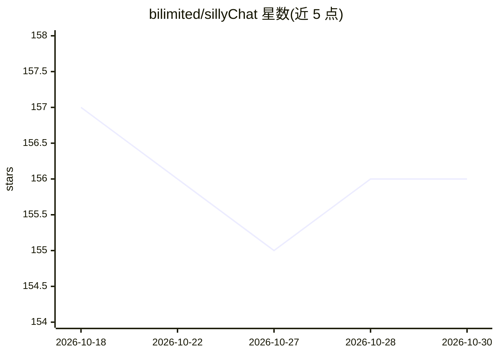

# bilimited/sillyChat

⭐ 156 · Dart · MIT · 推送 2026-07-17 · [GitHub](https://github.com/bilimited/sillyChat) · 个人维护 · 中文 README

**Flutter 开发的轻量级 AI 角色扮演聊天应用，支持桌面/移动端**

模仿 NextChat 和 SillyTavern 的 AI 聊天客户端，基于 Flutter，定位轻量、灵活。支持文件夹管理聊天、导入酒馆（SillyTavern）的角色卡/预设/世界书/正则（试验性，仅导入不支持导出）、角色关系网可视化、聊天记录搜索、webDav 云同步。API 方面支持 OpenAI、Gemini、DeepSeek 及兼容 OpenAI 的自定义模型，支持多模态图片与余额查询。安卓端下载 APK 安装，Windows 端解压 zip 运行 exe，无需部署。项目仍在开发中，以移动端为主，PC 端部分操作逻辑未适配，作者为个人开发者（研一学生）。

## 筛选速览

| 维度 | 判定 | 备注 |
|---|---|---|
| AI 角色 | `ai-native` | 本体是模型或模型工具 |
| 许可风险 | `permissive` | MIT |
| 部署形态 | `None` |  |
| 模型依赖 | locked-api |  |
| 硬件要求 | — | 无带数字的原话,不猜 |
| 安装摩擦 | `low` | 无编译、无系统依赖或容器化 |
| 成熟度 | `idea` | |

## 能力要点

- 导入酒馆角色卡、预设、世界书与正则（试验性兼容）
- 支持 OpenAI、Gemini、DeepSeek 及 OpenAI 兼容自定义 API
- 文件夹管理聊天、角色关系网可视化、webDav 云同步
- 安卓/Windows 免部署，解压即用

## 适用场景

- 在手机或电脑上进行 AI 角色扮演聊天
- 导入已有的酒馆角色卡与预设继续对话
- 通过自定义 OpenAI 兼容接口连接自有模型服务

## 场景标签

`聊天机器人` · 领域:对话与助手

## 证据(README 行号)

> L9: 本项目为自用分享。这是一个模仿NextChat和SillyTavern的AI聊天软件，基于Flutter开发，支持桌面/移动端。
> L32: - 🧩 实用功能：AI帮答、生成标题、生成总结、世界书条目临时激活
> L34: - 🔑	支持openAI、Gemini、DeepSeek和自定义API，支持余额查询

## 星数曲线

2026-10-18 157 → 2026-10-30 156（-1）

---
*卡片 v1 · prompt 1.4 · 生成 2026-10-22 · 置信度 high · 依据 README sha `238cb56a8b80` · [字段定义](../../DATASET.md)*
