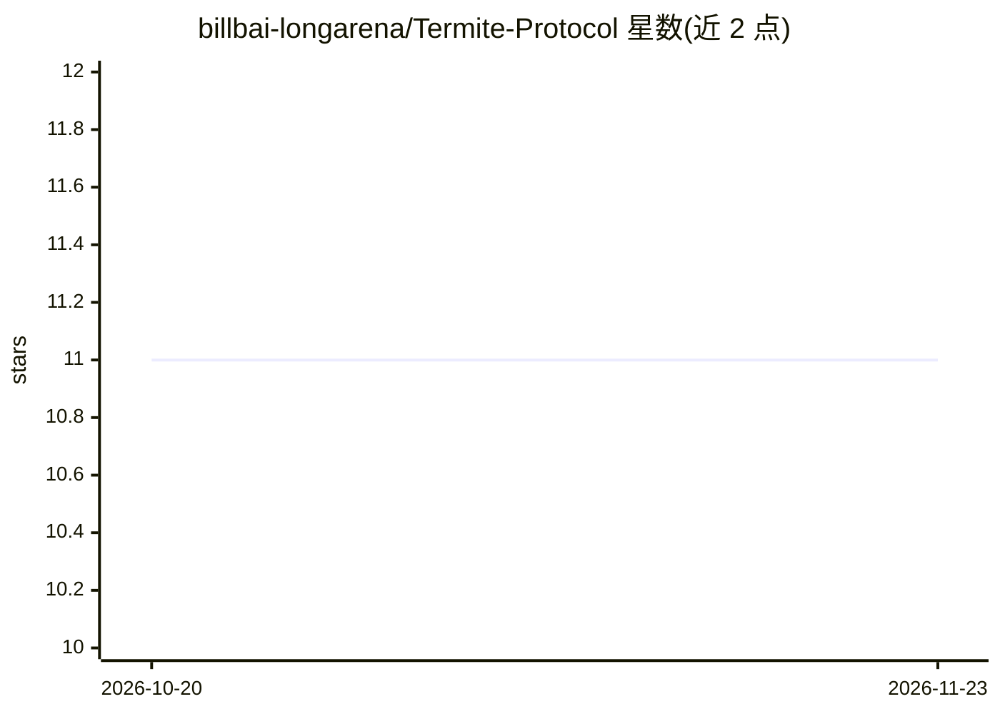

# billbai-longarena/Termite-Protocol

⭐ 11 · Shell · MIT · 推送 2026-08-31 · [GitHub](https://github.com/billbai-longarena/Termite-Protocol) · [官网](https://billbai-longarena.github.io/Termite-Protocol/) · 组织维护 · 中文 README

**为无状态 AI 编码 agent 提供跨会话环境化协作协议**

一套面向无状态 AI 编码 agent 的环境优先协调协议：协调信号持久化到 SQLite，任务认领通过事务保证原子性，观察记录以信息素式记忆累积；新 agent 到达时读取计算生成的 .birth 快照（≤800 tokens），替代阅读完整协议文档。通过 shell 脚本（field-arrive.sh 等）在真实项目仓库中运行，附实验数据与审计材料包，以 MIT 许可发布。

## 筛选速览

| 维度 | 判定 | 备注 |
|---|---|---|
| AI 角色 | `ai-ecosystem` | LLM/agent 周边工具 |
| 许可风险 | `permissive` | MIT |
| 部署形态 | `None` |  |
| 模型依赖 | — | README 未给出锁定关系 |
| 硬件要求 | — | 无带数字的原话,不猜 |
| 安装摩擦 | `low` | 无编译、无系统依赖或容器化 |
| 成熟度 | — | 结构信号不足 |

## 能力要点

- SQLite 事务实现的原子信号认领，避免重复分配与调度瓶颈
- .birth 快照将操作上下文压缩到 ≤800 tokens
- 重复证据可将观察提升为可复用规则
- 提供脚本化冒烟测试与实验审计包

## 适用场景

- 多 agent 并行开发时避免任务重复认领
- 强弱模型混用时让强模型示例引导弱模型
- 长期项目中跨会话沉淀协作记忆
- 需要可追溯信号的审计型重构工作

## 场景标签

`多智能体` `编码 Agent` · 领域:Agent 开发

## 证据(README 行号)

> L19: **Termite Protocol** is an environment-first coordination protocol for stateless AI coding agents.
> L29: - signals are persisted in SQLite
> L100: curl -fsSL https://raw.githubusercontent.com/billbai-longarena/Termite-Protocol/main/install.sh | bash

## 星数曲线

2026-10-20 11 → 2026-11-23 11（+0）

---
*卡片 v1 · prompt 1.4 · 生成 2026-11-18 · 置信度 high · 依据 README sha `293a6e3e16e4` · [字段定义](../../DATASET.md)*
