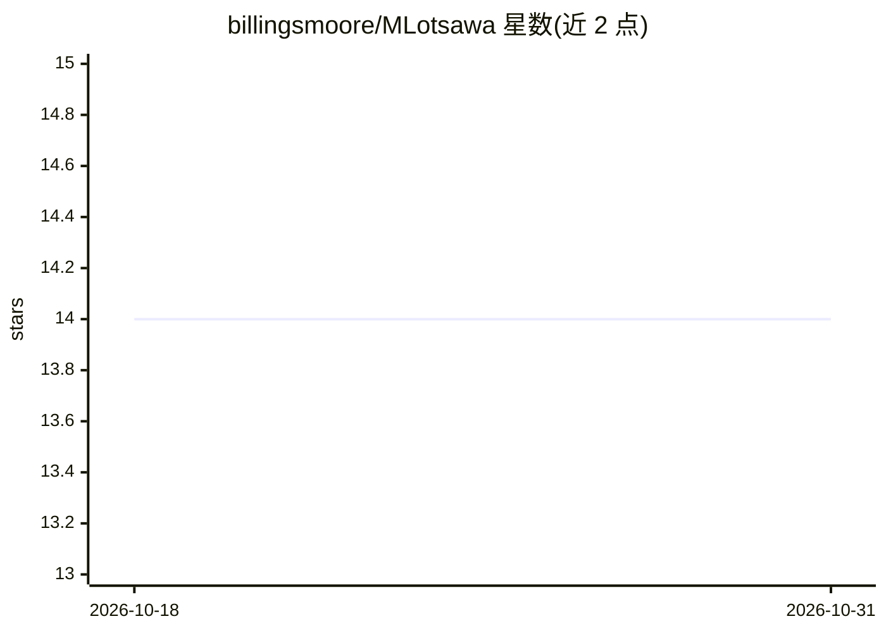

# billingsmoore/MLotsawa

⭐ 14 · Jupyter Notebook · 推送 2026-07-18 · [GitHub](https://github.com/billingsmoore/MLotsawa) · 个人维护

**文学藏文译英文的边缘设备神经翻译项目**

面向文学藏文（尤其藏传佛教文献）到英文的神经机器翻译研究项目，目标是在无独立 GPU、8GB 内存的普通电脑上本地运行，辅助而非替代人工译者。模型与数据集托管于 Hugging Face，训练与测试文档在 Docs 目录，论文涉及 T5 检索增强翻译与知识图谱。原 PyPI 模块与 WordPress/React 集成已弃用移除，目前推荐通过 Hugging Face Space 应用 SimpleTranslationUI 试用翻译（默认运行 mlotsawa-ground-base，提供 API key 可选 OpenRouter 模型）。仓库正处于重组中，多个子方向拆分为独立仓库。

## 筛选速览

| 维度 | 判定 | 备注 |
|---|---|---|
| AI 角色 | `ai-native` | 本体是模型或模型工具 |
| 许可风险 | `none` | — |
| 部署形态 | `library` | 以包/库形式分发 |
| 模型依赖 | — | README 未给出锁定关系 |
| 硬件要求 | — | 无带数字的原话,不猜 |
| 安装摩擦 | `low` | 无编译、无系统依赖或容器化 |
| 成熟度 | `idea` | |

## 能力要点

- 面向文学藏文-英文翻译，聚焦藏传佛教文献
- 目标在 8GB 内存、无独立 GPU 的普通电脑上本地运行
- 模型与数据集托管于 Hugging Face，含 T5 优化与知识图谱研究
- 关联项目覆盖 OCR 数据、领域标注、ASR/TTS 实验等子方向

## 适用场景

- 在普通笔记本电脑上辅助翻译藏文佛教文献
- 研究者复用藏英翻译模型与数据集进行实验
- 通过 SimpleTranslationUI 图形界面翻译 txt/docx/pdf 文档

## 场景标签

 · 领域:低资源语言机器翻译/藏文NLP

## 证据(README 行号)

> L11: This project is an attempt at creating user-friendly translation software to be used for translating from Literary 
> L13: The intended use case for this project is to be used locally on a reasonably priced computer of the kind that might
> L31: SimpleTranslationUI, a free

## 星数曲线

2026-10-18 14 → 2026-10-31 14（+0）

---
*卡片 v1 · prompt 1.4 · 生成 2026-10-31 · 置信度 mid · 依据 README sha `8999004c40d4` · [字段定义](../../DATASET.md)*
