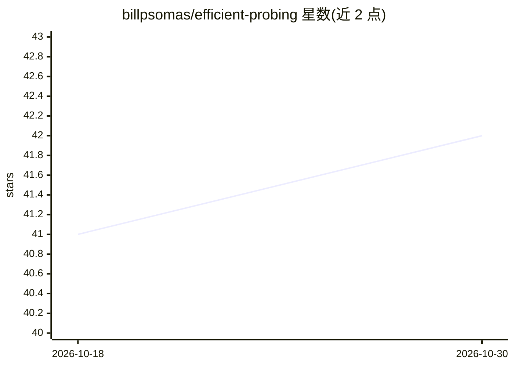

# billpsomas/efficient-probing

⭐ 42 · Python · Apache-2.0 · 推送 2026-09-22 · [GitHub](https://github.com/billpsomas/efficient-probing) · [官网](https://arxiv.org/abs/2506.10178) · 组织维护

**冻结视觉编码器探测基准：k-NN/线性/高效探测对比评测**

ICLR 2026 论文 Attention, Please! 的官方 PyTorch 实现，并发展为持续更新的 ImageNet-1k 基准。提出高效探测（EP）——轻量多查询交叉注意力机制，在冻结的预训练视觉编码器上聚合 patch 级特征，并产出可解释注意力图。基准以 k-NN（免训练）、线性探测（LP）、EP 三种方式评测 37 个 backbone 行，每行附日志与复现命令，EP 头可从 HuggingFace 下载；另支持 11 个其他数据集，并提供 ImageNet 打包工具。面向计算机视觉与自监督学习研究者。

## 筛选速览

| 维度 | 判定 | 备注 |
|---|---|---|
| AI 角色 | `ai-ecosystem` | LLM/agent 周边工具 |
| 许可风险 | `permissive` | Apache-2.0 |
| 部署形态 | `library` | 以包/库形式分发 |
| 模型依赖 | — | README 未给出锁定关系 |
| 硬件要求 | — | 无带数字的原话,不猜 |
| 安装摩擦 | `low` | 无编译、无系统依赖或容器化 |
| 成熟度 | — | 结构信号不足 |

## 能力要点

- EP：轻量多查询交叉注意力探测头，附可解释注意力图
- ImageNet-1k 上 k-NN/LP/EP 三方式对比的持续基准（37 行，含日志与复现命令）
- 每行 EP 头可在 HuggingFace 下载复现表格数字
- 支持 places365、CIFAR100、Food101 等 11 个额外数据集；提供 ImageNet 分片打包工具

## 适用场景

- 对比候选预训练视觉编码器的特征质量以辅助选型
- 复现论文的 attentive probing 结果或为新 backbone 贡献基准行
- 用 EP 头在冻结编码器上做参数高效的下游分类

## 场景标签

`模型评测` · 领域:评测与运维

## 证据(README 行号)

> L18: This repository is the official PyTorch implementation of **"Attention, Please! Revisiting
> L26: **The benchmark** evaluates frozen encoders three ways on ImageNet-1k &mdash; k-NN (nothing
> L27: trained), linear probing (a linear layer), and EP (a linear layer plus learned aggregation)

## 星数曲线

2026-10-18 41 → 2026-10-30 42（+1）

---
*卡片 v1 · prompt 1.4 · 生成 2026-10-25 · 置信度 high · 依据 README sha `74e66dd187c4` · [字段定义](../../DATASET.md)*
