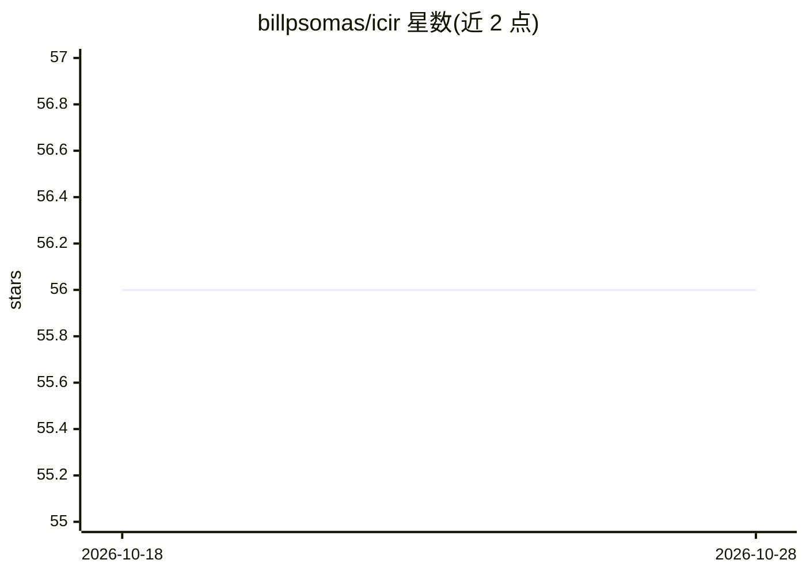

# billpsomas/icir

⭐ 56 · Python · MIT · 推送 2026-10-25 · [GitHub](https://github.com/billpsomas/icir) · [官网](https://vrg.fel.cvut.cz/icir/) · 组织维护

**实例级组合图像检索基准 i-CIR 与免训练方法 BASIC 官方实现**

NeurIPS 2025 论文 Instance-Level Composed Image Retrieval 的官方实现，含两部分：BASIC 是免训练方法，基于 CLIP/SigLIP 特征，经 LAION-1M 统计中心化、对比 PCA 投影、查询扩展与 Harris 融合完成组合图像检索；i-CIR 是实例级基准数据集，202 个实例、约 75 万图像、1,883 条组合查询，含视觉/文本/组合三类困难负样本。面向计算机视觉科研人员，需 Python 3.9+、PyTorch 2.0+，GPU 推荐；数据集经 tar 包或 Hugging Face WebDataset 下载。

## 筛选速览

| 维度 | 判定 | 备注 |
|---|---|---|
| AI 角色 | `ai-native` | 本体是模型或模型工具 |
| 许可风险 | `permissive` | MIT |
| 部署形态 | `library` | 以包/库形式分发 |
| 模型依赖 | — | README 未给出锁定关系 |
| 硬件要求 | — | 无带数字的原话,不猜 |
| 安装摩擦 | `medium` | 含编译或系统依赖之一 |
| 成熟度 | — | 结构信号不足 |

## 能力要点

- BASIC：免训练、基于 VLM 特征的组合图像检索方法（中心化+对比PCA+查询扩展+Harris融合）
- i-CIR 基准：202 实例、约 75 万图像、1,883 条组合查询与三类困难负样本
- 支持 CLIP ViT-L/14 与 SigLIP 两种骨干，输出 mAP 结果表
- 数据集提供 tar 包与 Hugging Face WebDataset 两种等价格式

## 适用场景

- 在 i-CIR 基准上评测组合图像检索方法
- 复现或扩展 BASIC 免训练检索方法
- 研究多模态图文组合检索的困难负样本构建

## 场景标签

`模型评测` `科研工具` · 领域:评测与运维

## 证据(README 行号)

> L20: Official implementation of our **B**aseline **A**pproach for **S**urpr**I**singly strong **C**omposition (**BASIC**
> L32: This repository contains a clean implementation for performing composed image retrieval (CIR) on **i-CIR** dataset 
> L250: |Method|ImageNet-R|NICO|Mini-DN|LTLL|i-CIR|

## 星数曲线

2026-10-18 56 → 2026-10-28 56（+0）

---
*卡片 v1 · prompt 1.4 · 生成 2026-10-24 · 置信度 mid · 依据 README sha `1b8807a83a0e` · [字段定义](../../DATASET.md)*
