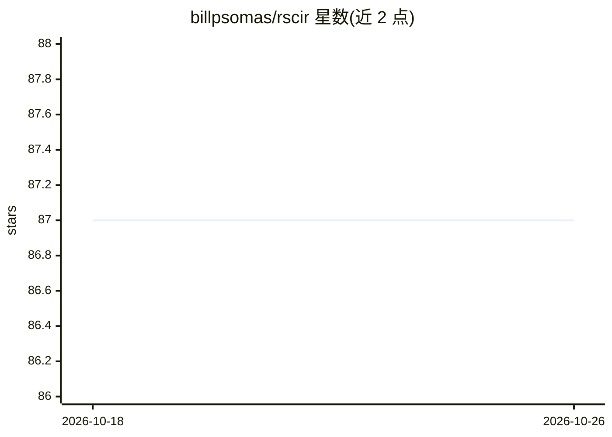

# billpsomas/rscir

⭐ 87 · Python · Apache-2.0 · 推送 2026-04-23 · [GitHub](https://github.com/billpsomas/rscir) · [官网](https://arxiv.org/abs/2405.15587) · 组织维护

**遥感组合图像检索（RSCIR）论文官方实现与基准数据集**

IGARSS 2024 ORAL 论文的 PyTorch 官方实现：提出遥感组合图像检索任务 RSCIR，将查询图像与查询文本结合，从遥感影像档案中检索视觉相似且符合文本修改要求（颜色、上下文、密度、存在性、数量、形状等属性）的图像。核心方法 WeiCom 基于 CLIP/RemoteCLIP 视觉-语言模型，免训练，通过权重参数 λ 调节图像或文本导向的结果。同时发布 PatterCom 基准数据集与评测协议，另含 xView2-CIR 和 LEVIR-CC 数据集文件。面向遥感与计算机视觉研究者使用。

## 筛选速览

| 维度 | 判定 | 备注 |
|---|---|---|
| AI 角色 | `ai-native` | 本体是模型或模型工具 |
| 许可风险 | `permissive` | Apache-2.0 |
| 部署形态 | `library` | 以包/库形式分发 |
| 模型依赖 | — | README 未给出锁定关系 |
| 硬件要求 | — | 无带数字的原话,不猜 |
| 安装摩擦 | `medium` | 含编译或系统依赖之一 |
| 成熟度 | — | 结构信号不足 |

## 能力要点

- 免训练的 WeiCom 方法，λ 参数控制图像/文本导向的检索结果
- 基于 CLIP 与 RemoteCLIP（ViT-L/14）提取特征
- PatterCom 基准数据集与评测协议（mAP 按属性组合计算）
- 提供特征提取与评测脚本，支持 xView2-CIR、LEVIR-CC 数据集

## 适用场景

- 在遥感影像档案中按'参考图像+文本修改描述'组合查询检索
- 复现论文中 WeiCom 与基线方法的 mAP 评测结果
- 在 PatterCom 基准上比较遥感组合图像检索方法

## 场景标签

`模型评测` `语义搜索` · 领域:评测与运维

## 证据(README 行号)

> L20: To tackle this constraint, we introduce a new task, remote sensing composed image retrieval. RSCIR, integrating bot
> L34: - We introduce remote sensing composed image retrieval (RSCIR), accompanied with PatterCom, a new benchmark dataset
> L35: - We introduce WeiCom, a training-free method utilizing a modality control parameter for more image- or text-orient

## 星数曲线

2026-10-18 87 → 2026-10-26 87（+0）

---
*卡片 v1 · prompt 1.4 · 生成 2026-10-23 · 置信度 mid · 依据 README sha `59a078a1fc4c` · [字段定义](../../DATASET.md)*
