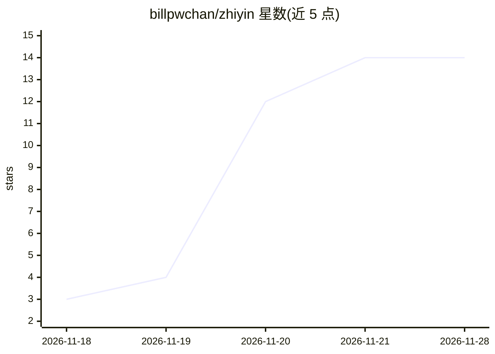

# billpwchan/zhiyin

⭐ 14 · Python · MIT · 推送 2026-11-14 · [GitHub](https://github.com/billpwchan/zhiyin) · [官网](https://zhiyin.billpwchan.art/?ref=github) · 个人维护 · 中文 README

**从你的音乐喜欢列表生成每周电台，Claude 选歌并说明理由**

个人化的每周音乐电台应用：读取用户在 YouTube Music（登录）或网易/QQ 音乐（粘贴歌单链接免登录）的喜欢歌曲，按音乐类型分站，每站从约 600 个候选中筛选，由 Claude 像编辑一样打分（0.7 以上才放出），并为每首歌写一句入选理由。播放经 YouTube 自带播放器，带同步歌词与翻译；跳过/喜欢实时重排队列，支持自然语言点播站。需 Python 3.13、uv 与 Claude Code，本地运行，数据留在本机。

## 筛选速览

| 维度 | 判定 | 备注 |
|---|---|---|
| AI 角色 | `ai-native` | 本体是模型或模型工具 |
| 许可风险 | `permissive` | MIT |
| 部署形态 | `None` |  |
| 模型依赖 | locked-api |  |
| 硬件要求 | — | 无带数字的原话,不猜 |
| 安装摩擦 | `low` | 无编译、无系统依赖或容器化 |
| 成熟度 | — | 结构信号不足 |

## 能力要点

- Claude 按编辑方式筛选候选，只放出评分 0.7 以上的歌曲并写入选理由
- MuQ-MuLan 音频模型按声音否决不喜欢的曲风，但不参与排序
- 自然语言点播：如'下雨的周日下午'约一分钟后生成电台
- 'Your ear'页面以圆盘可视化整个曲库的年份与类型分布

## 适用场景

- 每周获得基于个人喜欢歌曲的新电台，而非热门榜单
- 粘贴网易/QQ 音乐歌单链接，免登录生成口味画像卡片
- 边听边用'更安静''更多新歌手'等指令调整电台

## 场景标签

`推荐系统` · 领域:学习与行业

## 证据(README 行号)

> L25: Zhiyin starts from the few hundred songs you chose to like. For each kind of music you listen to, it gathers about
> L84: 4. An audio model, MuQ-MuLan, vetoes sounds you've turned down.

## 星数曲线

2026-11-18 3 → 2026-11-28 14（+11）

---
*卡片 v1 · prompt 1.4 · 生成 2026-11-20 · 置信度 high · 依据 README sha `99b1e49b1018` · [字段定义](../../DATASET.md)*
