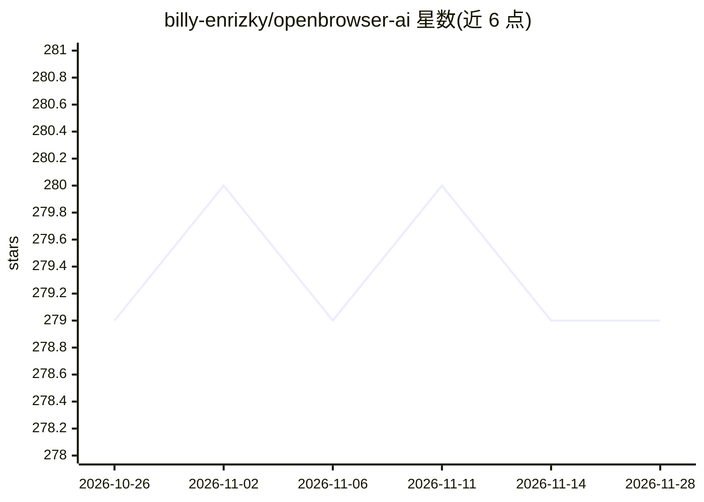

# billy-enrizky/openbrowser-ai

⭐ 279 · Python · MIT · 推送 2026-11-27 · [GitHub](https://github.com/billy-enrizky/openbrowser-ai) · [官网](https://docs.openbrowser.me/) · 个人维护

**面向开发者的 LLM 驱动浏览器自动化框架**

OpenBrowser 是一个浏览器自动化框架，结合 CDP 直连与 CodeAgent 架构：LLM 在持久化命名空间中编写并执行 Python 代码，完成网页导航、交互与信息提取。支持截图视觉理解、批量抓取、无浏览器 HTTP 模式、会话录制回放（导出 Jupyter/爬虫代码）、MCP Server 与 CLI 守护进程。提供 pip/brew/uv 等多种安装方式，自动检测本机 Chromium 系浏览器；托管云版含 cookie 保存与定时任务，需加入等候名单。

## 筛选速览

| 维度 | 判定 | 备注 |
|---|---|---|
| AI 角色 | `ai-ecosystem` | LLM/agent 周边工具 |
| 许可风险 | `permissive` | MIT |
| 部署形态 | `self-host` | docker 或自建部署 |
| 模型依赖 | local-ok | 支持本地模型 |
| 硬件要求 | — | 无带数字的原话,不猜 |
| 安装摩擦 | `low` | 无编译、无系统依赖或容器化 |
| 成熟度 | `idea` | |

## 能力要点

- CodeAgent 架构：LLM 在持久化命名空间写 Python 代码驱动浏览器
- 原生 CDP 通信，支持 15 个 LLM 提供商与本地模型
- MCP Server 可接入 Claude Desktop/Claude Code 等 AI 助手
- 批量抓取、工作流录制（导出 Notebook/爬虫代码）与视频录制

## 适用场景

- 自动抓取电商商品信息
- 让 LLM 自动完成订票、表单填写等网页流程
- 通过 Claude Code 等助手以 MCP 调用浏览器操作
- 批量抓取 URL 并输出 JSON/JSONL 结果

## 场景标签

`浏览器自动化` `网页抓取` · 领域:效率与自动化

## 证据(README 行号)

> L32: OpenBrowser is a framework for intelligent browser automation. It combines direct CDP communication with a CodeAgen
> L46: - **15 LLM Providers** - OpenAI, Anthropic, Google, Groq, AWS Bedrock, Azure, Ollama, DeepSeek, Cerebras, OpenRoute

## 星数曲线

2026-10-26 279 → 2026-11-28 279（+0）

---
*卡片 v1 · prompt 1.4 · 生成 2026-11-28 · 置信度 low · 依据 README sha `8303ab6f7d96` · [字段定义](../../DATASET.md)*
