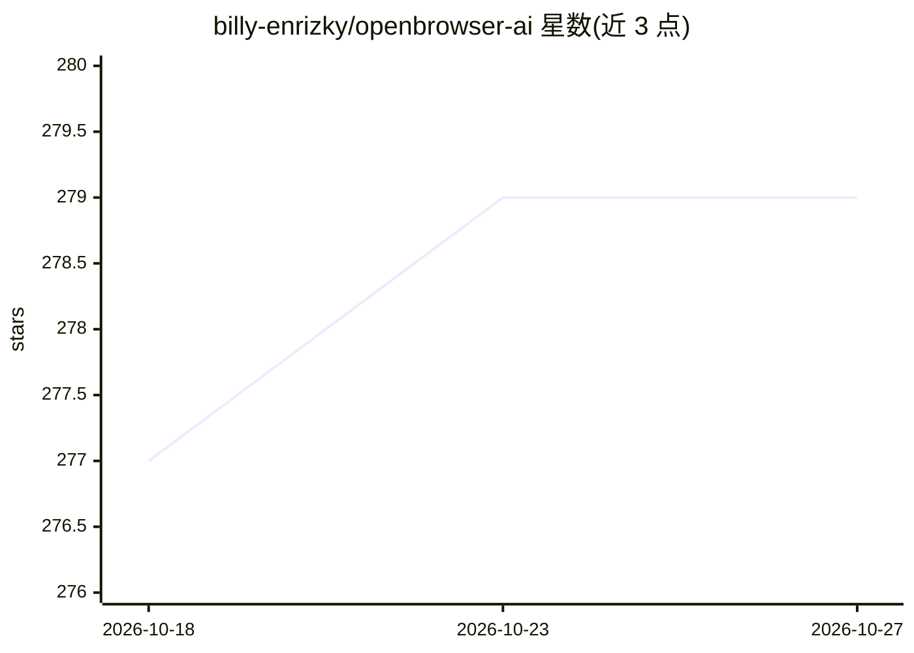

# billy-enrizky/openbrowser-ai

⭐ 279 · Python · MIT · 推送 2026-09-28 · [GitHub](https://github.com/billy-enrizky/openbrowser-ai) · [官网](https://docs.openbrowser.me/) · 个人维护

**面向开发者的 AI 浏览器自动化框架，LLM 写代码控制网页**

Python 框架，通过直连 CDP（Chrome DevTools Protocol）与 CodeAgent 架构实现智能浏览器自动化：LLM 在持久化类 Jupyter 命名空间中编写并执行 Python 代码，完成页面导航、交互与信息抽取。支持 15 个 LLM 提供商（OpenAI、Anthropic、Google、Ollama 等），内置 MCP Server（单 execute_code 工具）、CLI 守护进程、会话录制导出为 Jupyter notebook、Claude Code 插件（7 个技能）。自动检测已装 Chromium 内核浏览器，无需单独安装浏览器。提供云端托管版（域名 openbrowser.me，含 Web UI 与定时任务）。

## 筛选速览

| 维度 | 判定 | 备注 |
|---|---|---|
| AI 角色 | `ai-native` | 本体是模型或模型工具 |
| 许可风险 | `permissive` | MIT |
| 部署形态 | `self-host` | docker 或自建部署 |
| 模型依赖 | local-ok | 支持本地模型 |
| 硬件要求 | — | 无带数字的原话,不猜 |
| 安装摩擦 | `low` | 无编译、无系统依赖或容器化 |
| 成熟度 | `idea` | |

## 能力要点

- CodeAgent 架构：LLM 在持久化命名空间中编写 Python 代码控制浏览器
- 直连 CDP 通信，自动检测 Chrome/Edge/Brave/Chromium
- 支持 15 个 LLM 提供商含本地 Ollama
- MCP Server、CLI 守护进程、会话录制导出、Claude Code 插件（7 技能）

## 适用场景

- 让 LLM 自动抓取网页数据、填表、登录
- 通过 MCP 接入 Claude Desktop/Code 等 AI 助手做浏览器操作
- 录制浏览器会话并导出为 Jupyter notebook 或爬虫代码
- 端到端测试与页面无障碍审计

## 场景标签

`浏览器自动化` `网页抓取` · 领域:效率与自动化

## 证据(README 行号)

> L30: **AI-powered browser automation using CodeAgent and CDP (Chrome DevTools Protocol)**
> L32: OpenBrowser is a framework for intelligent browser automation. It combines direct CDP communication with a CodeAgen
> L42: - **CodeAgent Architecture** - LLM writes Python code in a persistent Jupyter-like namespace for browser automation

## 星数曲线

2026-10-18 277 → 2026-10-27 279（+2）

---
*卡片 v1 · prompt 1.4 · 生成 2026-10-22 · 置信度 mid · 依据 README sha `b500d86dd880` · [字段定义](../../DATASET.md)*
