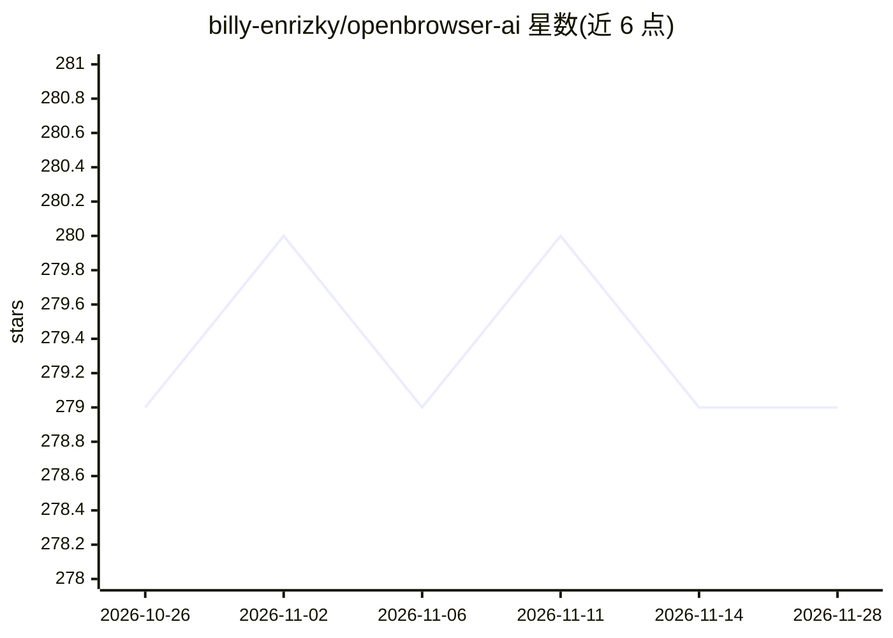

# billy-enrizky/openbrowser-ai

⭐ 279 · Python · MIT · 推送 2026-11-27 · [GitHub](https://github.com/billy-enrizky/openbrowser-ai) · [官网](https://docs.openbrowser.me/) · 个人维护

**LLM 写 Python 代码驱动浏览器的自动化框架**

基于 CDP 直连与 CodeAgent 架构的浏览器自动化框架：LLM 在持久命名空间中编写并执行 Python 代码，完成网页导航、交互与信息提取。支持 15 家 LLM 提供商、截图视觉理解、批量抓取、工作流录制回放、视频录制与 MCP Server 接入 Claude Desktop/Claude Code 等客户端。提供 CLI daemon、插件系统（8 个引导技能），另有托管云版本（等待名单）。要求 Python 3.12+，自动检测已装的 Chromium 系浏览器。

## 筛选速览

| 维度 | 判定 | 备注 |
|---|---|---|
| AI 角色 | `ai-ecosystem` | LLM/agent 周边工具 |
| 许可风险 | `permissive` | MIT |
| 部署形态 | `self-host` | docker 或自建部署 |
| 模型依赖 | local-ok | 支持本地模型 |
| 硬件要求 | — | 无带数字的原话,不猜 |
| 安装摩擦 | `low` | 无编译、无系统依赖或容器化 |
| 成熟度 | — | 结构信号不足 |

## 能力要点

- CodeAgent 架构：LLM 在类 Jupyter 持久命名空间中写 Python 代码驱动浏览器
- 原生 DDGS 网页搜索客户端与批量抓取（有界并发，--no-browser 模式不启动 Chrome）
- MCP Server 支持 Claude Desktop、Claude Code、Codex、OpenCode 等客户端
- 工作流录制可回放并导出为 Jupyter notebook 或 API 爬虫代码

## 适用场景

- 自动抓取电商商品页数据并批量导出 JSON/JSONL
- 让 AI 代理自动完成表单填写、机票预订等网页操作
- 把 Claude Code 等客户端接入浏览器自动化能力（MCP）
- 录制浏览器会话并导出为可复用的工作流代码

## 场景标签

`浏览器自动化` `网页抓取` · 领域:效率与自动化

## 证据(README 行号)

> L32: OpenBrowser is a framework for intelligent browser automation. It combines direct CDP communication with a CodeAgen
> L42: - **CodeAgent Architecture** - LLM writes Python code in a persistent Jupyter-like namespace for browser automation
> L47: - **MCP Server** - Model Context Protocol for Claude Desktop, Claude Code, Codex, OpenCode, and other AI assistants

## 星数曲线

2026-10-26 279 → 2026-11-28 279（+0）

---
*卡片 v1 · prompt 1.4 · 生成 2026-11-27 · 置信度 low · 依据 README sha `4971dc41e6e2` · [字段定义](../../DATASET.md)*
