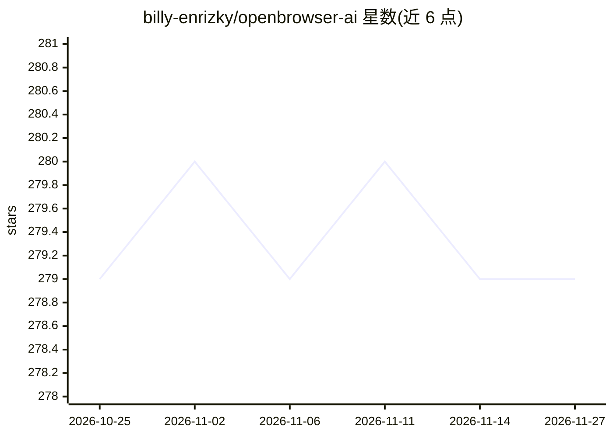

# billy-enrizky/openbrowser-ai

⭐ 279 · Python · MIT · 推送 2026-11-26 · [GitHub](https://github.com/billy-enrizky/openbrowser-ai) · [官网](https://docs.openbrowser.me/) · 个人维护

**开发者用 LLM 编写代码驱动的浏览器自动化框架**

基于 CDP（Chrome DevTools Protocol）直连与 CodeAgent 架构的浏览器自动化框架：LLM 在持久化命名空间中生成并执行 Python 代码，完成网页导航、交互与信息提取。提供 CLI（含常驻 daemon、批量抓取、无浏览器 HTTP 模式）、MCP Server（供 Claude Desktop/Claude Code 等调用）、工作流录制回放、视频录制、插件系统与 8 个引导技能。支持 15 个 LLM 提供商，自动检测本机 Chromium 系浏览器，要求 Python 3.12+。

## 筛选速览

| 维度 | 判定 | 备注 |
|---|---|---|
| AI 角色 | `ai-ecosystem` | LLM/agent 周边工具 |
| 许可风险 | `permissive` | MIT |
| 部署形态 | `self-host` | docker 或自建部署 |
| 模型依赖 | local-ok | 支持本地模型 |
| 硬件要求 | — | 无带数字的原话,不猜 |
| 安装摩擦 | `low` | 无编译、无系统依赖或容器化 |
| 成熟度 | — | 结构信号不足 |

## 能力要点

- CodeAgent 架构：LLM 在持久 Jupyter 式命名空间中写 Python 代码执行自动化
- 原生 CDP 通信与 CLI 常驻 daemon（-c 直接执行代码，10 分钟自动关闭）
- MCP Server 供 Claude Desktop、Claude Code、Codex 等接入
- 批量抓取 scrape_pages 支持并发上限与 --no-browser 轻量 HTTP 模式

## 适用场景

- 自动抓取电商商品数据并批量导出 JSON/JSONL
- 让 LLM 自动完成订票、表单填写等网页流程
- 把浏览器自动化能力通过 MCP 接入 Claude Code 等 AI 助手
- 录制并回放浏览器工作流，导出为 Jupyter notebook 或爬虫代码

## 场景标签

`浏览器自动化` `网页抓取` · 领域:效率与自动化

## 证据(README 行号)

> L32: OpenBrowser is a framework for intelligent browser automation. It combines direct CDP communication with a CodeAgen
> L42: - **CodeAgent Architecture** - LLM writes Python code in a persistent Jupyter-like namespace for browser automation
> L47: - **MCP Server** - Model Context Protocol for Claude Desktop, Claude Code, Codex, OpenCode, and other AI assistants

## 星数曲线

2026-10-25 279 → 2026-11-27 279（+0）

---
*卡片 v1 · prompt 1.4 · 生成 2026-11-26 · 置信度 low · 依据 README sha `3a9148a3b8c2` · [字段定义](../../DATASET.md)*
