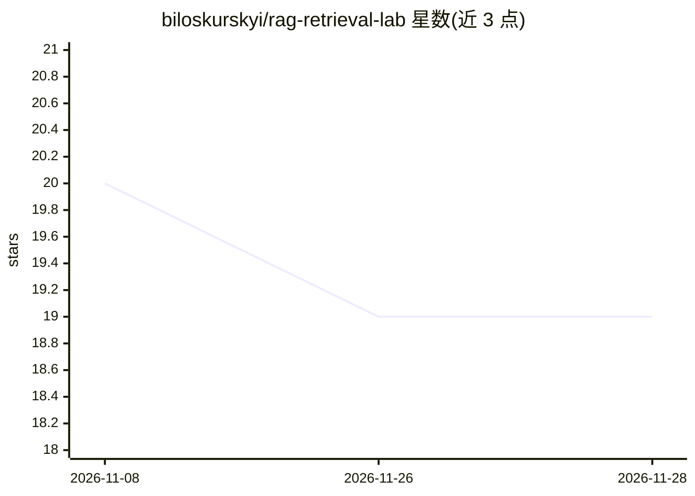

# biloskurskyi/rag-retrieval-lab

⭐ 19 · Python · MIT · 推送 2026-11-04 · [GitHub](https://github.com/biloskurskyi/rag-retrieval-lab) · 个人维护

**单接口下对比 15 种 RAG 检索策略的学习/评测实验项目**

把 dense、BM25、混合检索、查询变换（multi-query/HyDE）、corrective、agentic、adaptive 路由等 15 种 RAG 检索策略统一到同一接口，在同一双语语料（虚构云存储公司 CloudBox）上用 hit@k、MRR、nDCG@k、答案召回与 faithfulness 指标对比。默认离线运行：确定性哈希 embedder 与抽取式 FakeLLM 替代付费 API；可通过适配器接入 Postgres+pgvector（HNSW+tsvector）、sentence-transformers、OpenAI 兼容端点或 Ollama。含 100+ pytest 测试、JSON 追踪与 docker compose 起库脚本。语料小，绝对指标依赖真实模型。

## 筛选速览

| 维度 | 判定 | 备注 |
|---|---|---|
| AI 角色 | `ai-ecosystem` | LLM/agent 周边工具 |
| 许可风险 | `permissive` | MIT |
| 部署形态 | `self-host` | docker 或自建部署 |
| 模型依赖 | local-ok | 支持本地模型 |
| 硬件要求 | — | 无带数字的原话,不猜 |
| 安装摩擦 | `low` | 无编译、无系统依赖或容器化 |
| 成熟度 | — | 结构信号不足 |

## 能力要点

- 15 种检索策略统一接口与对比 CLI（ingest/ask/compare/eval）
- 默认离线可复现：哈希 embedder + 抽取式 FakeLLM，无需 API key
- 评测套件：golden YAML 问答、hit@k/MRR/nDCG@k/答案召回/faithfulness（可选 LLM-as-judge）
- pgvector HNSW + tsvector 全文检索后端与嵌套 JSON 追踪

## 适用场景

- 在同一语料与指标下比较多种 RAG 检索策略的效果与开销
- 学习 corrective、agentic、adaptive 等策略的实现机制
- 以真实 Postgres+pgvector 或 Ollama 环境复现评测

## 场景标签

`RAG` `模型评测` `教程课程` · 领域:评测与运维

## 证据(README 行号)

> L5: A learning project that puts **15 retrieval-augmented generation (RAG) strategies behind one
> L19: - an **eval suite**: golden Q&A in YAML, hit@k, MRR, nDCG@k, answer recall and a faithfulness
> L124: `rag-lab eval` scores every strategy on `eval/golden.yaml` (16 questions,

## 星数曲线

2026-11-08 20 → 2026-11-28 19（-1）

---
*卡片 v1 · prompt 1.4 · 生成 2026-11-18 · 置信度 mid · 依据 README sha `fcbec50be8bc` · [字段定义](../../DATASET.md)*
