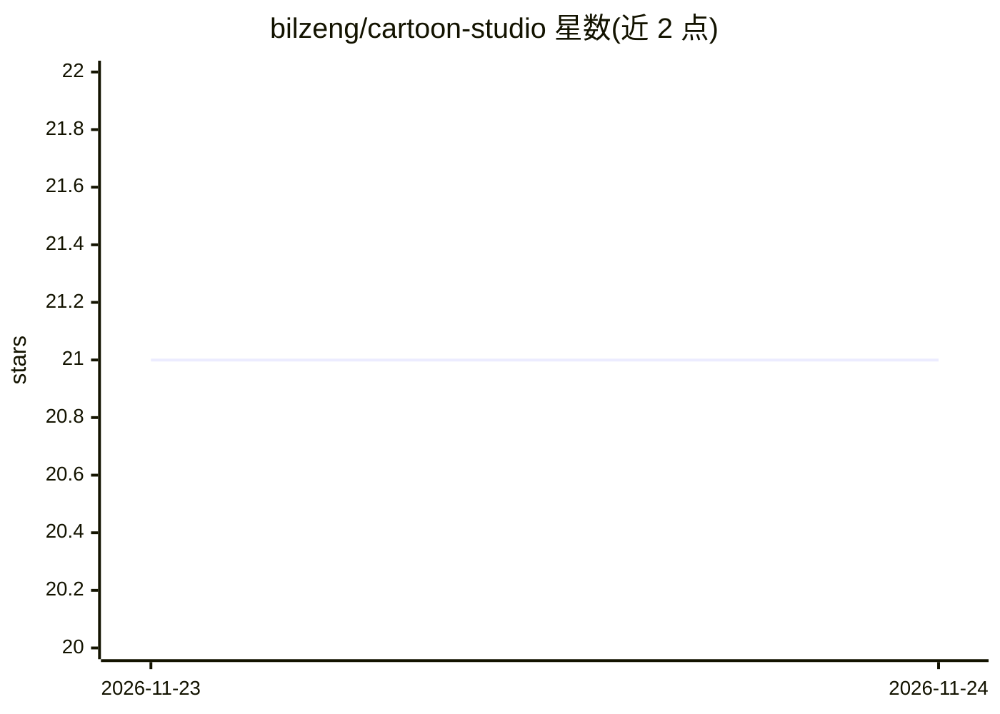

# bilzeng/cartoon-studio

⭐ 21 · JavaScript · Apache-2.0 · 推送 2026-11-20 · [GitHub](https://github.com/bilzeng/cartoon-studio) · 个人维护 · 中文 README

**给个人创作者的本地分镜编排与 AI 漫剧生成工作台**

镜场是运行在本机的开源短片与 AI 漫剧工作台：在节点画布组织参考素材，按剧本拆分镜头并编排分镜，通过接入的 ComfyUI 服务生成图像、视频与旁白，最终从分镜台导出带配乐的 MP4。内置 3D 导演台、PoseSwap 姿势换装、RelayVSR 高清修复、H3 两段续接等功能，支持导入自定义工作流 JSON。需 Node.js 24+ 与 FFmpeg；生成依赖外部 ComfyUI 环境，模型权重由该环境管理。

## 筛选速览

| 维度 | 判定 | 备注 |
|---|---|---|
| AI 角色 | `ai-native` | 本体是模型或模型工具 |
| 许可风险 | `permissive` | Apache-2.0 |
| 部署形态 | `None` |  |
| 模型依赖 | — | README 未给出锁定关系 |
| 硬件要求 | — | 无带数字的原话,不猜 |
| 安装摩擦 | `medium` | 含编译或系统依赖之一 |
| 成熟度 | — | 结构信号不足 |

## 能力要点

- 节点画布编排素材，@ 引用参考图，逐镜设置景别、运镜、对白与时长
- 通过 ComfyUI API 提交生成工作流，支持发现 Krea2、Qwen Image 2.1、Z-Image Turbo 等模型
- 导入编辑器/API 格式的工作流 JSON 并做模型文件映射
- Windows/macOS/Linux 便携启动脚本与内置更新按钮

## 适用场景

- 把剧本拆成分镜并逐镜生成图像视频，导出成片
- 用自己的 ComfyUI 工作流做姿势换装和高清修复
- 制作多集漫剧并跨集复用角色、场景、道具设定卡

## 场景标签

`图像生成` `视频生成` · 领域:内容生成

## 证据(README 行号)

> L11: 镜场是一款运行在本机的开源短片与 AI 漫剧工作台。你可以在节点画布上组织参考素材，按剧本拆分和编排镜头，用自己的 ComfyUI 工作流生成图像、视频与旁白，再从分镜台导出 MP4。
> L106: 感谢以下项目。镜场通过 ComfyUI API 调用生成能力，所需插件由使用者按工作流安装。

## 星数曲线

2026-11-23 21 → 2026-11-24 21（+0）

---
*卡片 v1 · prompt 1.4 · 生成 2026-11-23 · 置信度 high · 依据 README sha `f3d85b707b92` · [字段定义](../../DATASET.md)*
