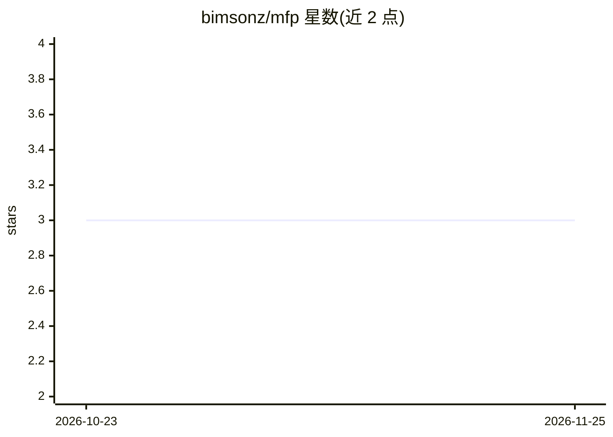

# bimsonz/mfp

⭐ — · [GitHub]() · 个人维护

**模型向驱动方回报工作内容的类型化消息格式规范**

MFP 定义一种小型类型化消息格式，用于模型向驱动它的程序报告意图、前提、决策、观察、立场与结论六类消息。前提与效果是建立在有序谓词上的类型化命题，消费方可据此判断某变更的效果是否与另一方的依据矛盾。提供 JSON Schema 2020-12 线格式、结构化输出 schema、MCP 工具定义与 profile 检查器，TypeSpec 库为 schema 的单一来源。npm 安装，附带规范文档、示例、一致性测试与评测目录。

## 筛选速览

| 维度 | 判定 | 备注 |
|---|---|---|
| AI 角色 | `ai-ecosystem` | LLM/agent 周边工具 |
| 许可风险 | `permissive` | — |
| 部署形态 | `library` | 以包/库形式分发 |
| 模型依赖 | — | README 未给出锁定关系 |
| 硬件要求 | — | 无带数字的原话,不猜 |
| 安装摩擦 | `low` | 无编译、无系统依赖或容器化 |
| 成熟度 | `idea` | |

## 能力要点

- 六类消息：intent、premise、decision、observation、stance、verdict
- 每类消息提供结构化输出 schema 与 MCP 工具定义
- TypeSpec 库作为 schema 的单一来源，pnpm 重新生成
- 带 profile 检查器与 mfp-profile 命令行

## 适用场景

- 为 agent 流程标准化模型对自身工作的报告
- 将 MFP 作为 MCP 工具接入模型的工具调用链路
- 用结构化输出 schema 约束模型按格式回报

## 场景标签

 · 领域:LLM 基础设施/协议规范

## 证据(README 行号)

> L3: MFP (Model Feedback Protocol) is a small, typed message format for what a model reports back to whatever drives it: 
> L12: - **Schemas for every use:** a wire schema (JSON Schema 2020-12), a producer schema, and per kind a structured-outp

## 星数曲线

2026-10-23 3 → 2026-11-25 3（+0）

---
*卡片 v1 · prompt 1.4 · 生成 2026-11-22 · 置信度 high · 依据 README sha `48af77b13b94` · [字段定义](../../DATASET.md)*
