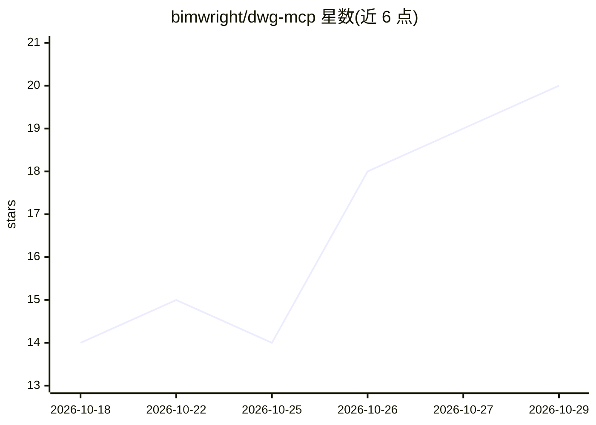

# bimwright/dwg-mcp

⭐ 20 · C# · Apache-2.0 · 推送 2026-10-24 · [GitHub](https://github.com/bimwright/dwg-mcp) · 组织维护 · 中文 README

**AutoCAD 2022-2027 的本地 MCP 网关：让 AI 代理读写翻译图纸文字**

由 .NET 8 MCP 服务器（Bimwright.Dwg.Server）与各版本 AutoCAD 插件（Bimwright.Dwg.Plugin）两部分组成，供 Claude Code、Cursor、OpenCode 等 stdio MCP 客户端调用，代理可读取选中文本、原地翻译重写、执行 C# 代码。机制包括空间聚类将碎片文字组成逻辑句、自动创建 Unicode 文本样式替代 SHX 字体、CJK 高度补偿、MText 转换与单次撤销事务；服务器与插件经 TCP NDJSON（2022-2024）或回环 Named Pipe（2025-2027）通信，全部在本机运行。限制：dwg_run_lisp 拒绝所有请求，代码执行仅限内联同步片段。

## 筛选速览

| 维度 | 判定 | 备注 |
|---|---|---|
| AI 角色 | `ai-ecosystem` | LLM/agent 周边工具 |
| 许可风险 | `permissive` | Apache-2.0 |
| 部署形态 | `desktop` | 安装包/桌面程序 |
| 模型依赖 | — | README 未给出锁定关系 |
| 硬件要求 | — | 无带数字的原话,不猜 |
| 安装摩擦 | `medium` | 含编译或系统依赖之一 |
| 成熟度 | — | 结构信号不足 |

## 能力要点

- 空间聚类按块/行/列/段落将碎片文字组成逻辑句
- 自动创建 Unicode 文本样式并做 CJK 高度补偿，单次撤销事务
- 支持 get_selected_texts、translate_and_rewrite、send_code 等工具集
- --read-only 模式剥离写能力工具集，dwg_health 离线只读健康检查

## 适用场景

- 让 AI 代理把图纸上的外语技术文字批量原地翻译为越南语/CJK 语言
- 通过 MCP 客户端对 AutoCAD 图纸执行文字读取与批量更新
- 代理在图纸数据库上执行内联 C# 代码完成定制操作

## 场景标签

`AI 写作` · 领域:内容生成

## 证据(README 行号)

> L22: `dwg-mcp` is a local MCP gateway for Autodesk AutoCAD 2022-2027 DWG workflows.
> L26: - **Bimwright.Dwg.Server**: a .NET 8 MCP server launched by Claude Code, Cursor, OpenCode, or another stdio MCP cli

## 星数曲线

2026-10-18 14 → 2026-10-29 20（+6）

---
*卡片 v1 · prompt 1.4 · 生成 2026-10-28 · 置信度 high · 依据 README sha `6cf9e79d02de` · [字段定义](../../DATASET.md)*
