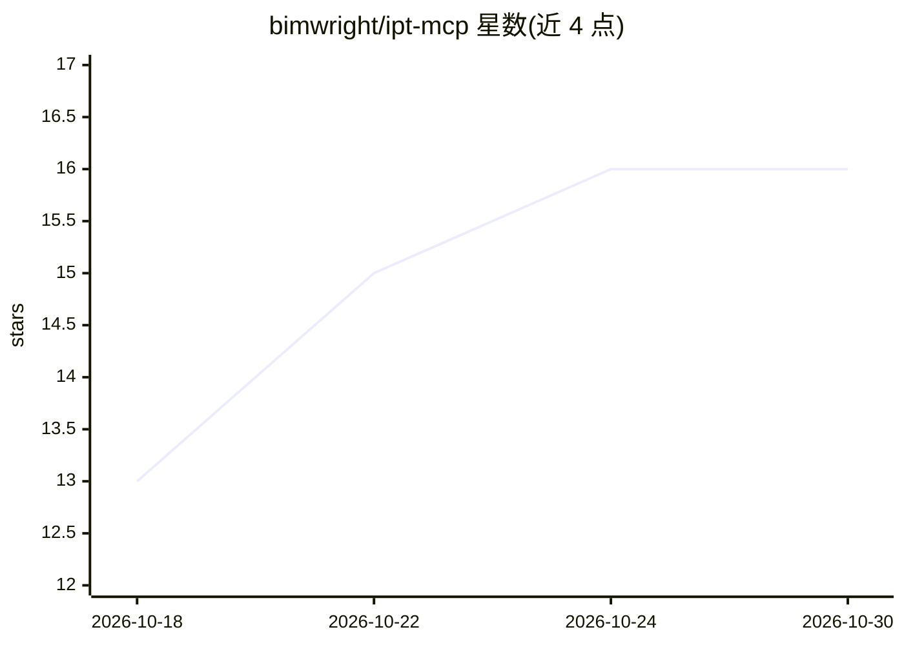

# bimwright/ipt-mcp

⭐ 16 · C# · Apache-2.0 · 推送 2026-10-05 · [GitHub](https://github.com/bimwright/ipt-mcp) · 组织维护 · 中文 README

**让 Claude Code 等 MCP 客户端本地驱动 Autodesk Inventor 的 MCP 网关**

面向 Autodesk Inventor 2022-2027 的开源（Apache-2.0）MCP stdio 网关，供 Claude Code、Cursor、Cline、Codex 等 MCP 客户端在本地驱动 Inventor。架构为两个进程：.NET 8 MCP stdio 服务器（不含 Inventor 引用）通过 TCP（2022-2024）或 Named Pipe（2025-2027）与运行在 Inventor.exe 内的逐版本 add-in 通信，add-in 将命令封送到 Inventor STA 线程执行。默认提供 58 个 inventor_ 前缀工具，覆盖文档、参数、iProperties、草图、特征、装配、导出（STEP/STL/DXF/PNG）等；长度输入以 mm 计。v0.1.0 安装 ZIP 附带 2025 与 2027 两个年度 add-in，其余版本需本机编译；inventor_send_code 默认关闭需双重开启。模型与文件留在本机。

## 筛选速览

| 维度 | 判定 | 备注 |
|---|---|---|
| AI 角色 | `ai-ecosystem` | LLM/agent 周边工具 |
| 许可风险 | `permissive` | Apache-2.0 |
| 部署形态 | `desktop` | 安装包/桌面程序 |
| 模型依赖 | — | README 未给出锁定关系 |
| 硬件要求 | — | 无带数字的原话,不猜 |
| 安装摩擦 | `high` | 编译与系统依赖俱全 |
| 成熟度 | — | 结构信号不足 |

## 能力要点

- 58 个 MCP 工具覆盖文档/参数/iProperties/草图/特征/装配/导出（STEP、STL、DXF、PNG）
- 支持 Inventor 2022-2027，按年度选择 net48 或 .NET 8/10 add-in
- TCP（2022-2024）与 Named Pipe（2025-2027）两种本地认证传输
- inventor_send_code 默认关闭，需服务器与插件双重显式开启

## 适用场景

- 用 Claude Code 等对话式客户端在 Inventor 中建模、改参数、出工程图
- 通过 MCP 自动化零件/装配文档的创建与 STEP/STL 导出
- 在一个 MCP 客户端里查询和修改 Inventor 模型参数与 iProperties

## 场景标签

 · 领域:CAD 自动化/工程工具

## 证据(README 行号)

> L10: `ipt-mcp` is an open-source (Apache-2.0) Model Context Protocol gateway that lets Claude Code — and any MCP-capable
> L12: The agent speaks MCP over stdio. The server speaks NDJSON over a local authenticated transport (TCP or Named Pipe) 
> L35: - **`Bimwright.Ipt.Server.exe`** — a .NET 8 MCP stdio server launched by Claude Code, Cursor, Cline, Codex, or anot

## 星数曲线

2026-10-18 13 → 2026-10-30 16（+3）

---
*卡片 v1 · prompt 1.4 · 生成 2026-10-30 · 置信度 high · 依据 README sha `2e253d6d701a` · [字段定义](../../DATASET.md)*
