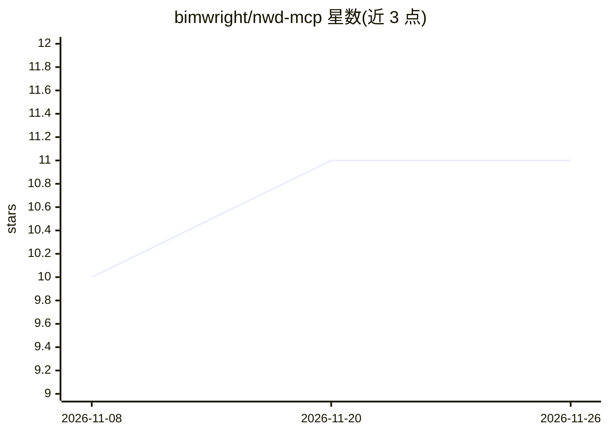

# bimwright/nwd-mcp

⭐ 11 · C# · Apache-2.0 · 推送 2026-11-25 · [GitHub](https://github.com/bimwright/nwd-mcp) · 组织维护 · 中文 README

**让 AI agent 通过 MCP 查询与脚本化操作 Navisworks 的网关**

面向 Autodesk Navisworks Manage 的 Model Context Protocol 网关，通过 stdin/stdout 让本地 AI agent 查询、检查、导航并脚本化操作 Navisworks 桌面会话。采用两进程模型：.NET 8 控制台服务器与版本专属的进程内插件通信，回环 TCP NDJSON 传输，支持 2022–2027 六个版本。提供 35 个 nwd_* 工具（只读模式 25 个），覆盖目标路由、文件、查询、选择集、视点、可见性、C# 脚本与 ToolBaker 工具编译；含逐会话令牌校验、多实例 PID 路由与写入确认机制。仅支持 Manage 版本（Freedom/Simulate 不支持），Windows 平台。

## 筛选速览

| 维度 | 判定 | 备注 |
|---|---|---|
| AI 角色 | `ai-ecosystem` | LLM/agent 周边工具 |
| 许可风险 | `permissive` | Apache-2.0 |
| 部署形态 | `desktop` | 安装包/桌面程序 |
| 模型依赖 | — | README 未给出锁定关系 |
| 硬件要求 | — | 无带数字的原话,不猜 |
| 安装摩擦 | `medium` | 含编译或系统依赖之一 |
| 成熟度 | — | 结构信号不足 |

## 能力要点

- 35 个 MCP 工具覆盖查询、选择、视点、可见性与 C# 脚本执行
- 多实例路由：PID/ID/年份/auto 选择器与写入前文档确认机制
- 回环 TCP 传输 + 逐会话随机令牌校验 + 文件路径脱敏
- ToolBaker 可将建议工作流编译为可复用工具

## 适用场景

- 让 Claude 等 MCP 客户端查询模型树与构件属性
- AI 辅助导航视点、控制构件显隐
- 通过 nwd_send_code 在 UI 线程运行 C# 脚本做批量操作
- 多个 Navisworks 实例并行时为 agent 固定目标会话

## 场景标签

`GUI 自动化` · 领域:效率与自动化

## 证据(README 行号)

> L12: `nwd-mcp` is a professional-grade Model Context Protocol (MCP) gateway for **Autodesk Navisworks Manage** automatio
> L17: - **Two-Process Model:** Lightweight `.NET 8` console server communicating with a version-specific in-process plug-
> L60: A default launch registers every toolset: **35 tools**. `--read-only` leaves **25**. Every tool uses the `nwd_*` pr

## 星数曲线

2026-11-08 10 → 2026-11-26 11（+1）

---
*卡片 v1 · prompt 1.4 · 生成 2026-11-19 · 置信度 high · 依据 README sha `d265c31c9537` · [字段定义](../../DATASET.md)*
