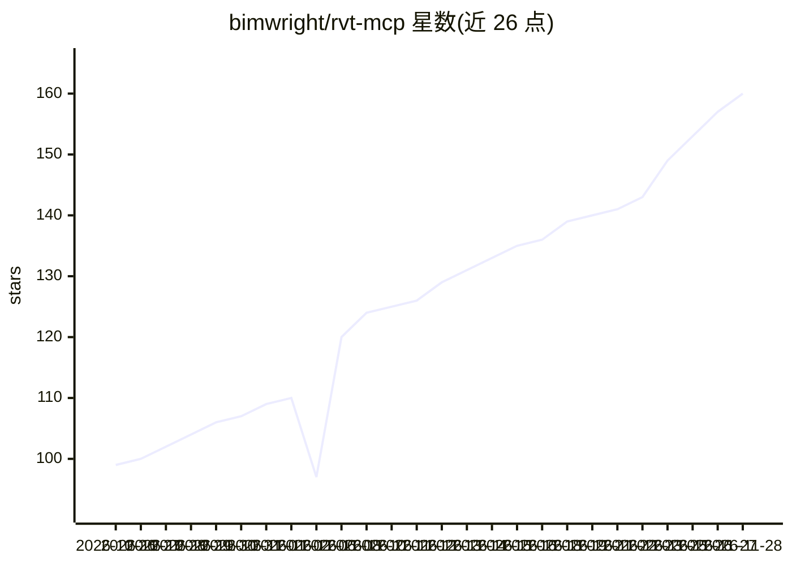

# bimwright/rvt-mcp

⭐ 160 · C# · Apache-2.0 · 推送 2026-11-27 · [GitHub](https://github.com/bimwright/rvt-mcp) · [官网](https://github.com/bimwright/rvt-mcp) · 个人维护

**让 AI agent 通过 MCP 操作本地 Revit 的网关**

连接 MCP 客户端与本机 Revit 会话的桥接网关：.NET 10 服务器经 stdio 提供 MCP 协议，逐年份的 Revit 插件在 Revit 内部经 localhost TCP（≤2024）或命名管道（≥2025）通信，数据不出本机。提供 257 个类型化工具覆盖查询、创建、视图、明细表、注释、导出（PDF/DWG/IFC/NWC）、结构/机电等领域操作，无合适工具时可经 revit_send_code_to_revit 在 Revit 内编译 C#；ToolBaker 可将重复调用固化为个人工具。安装提供 Setup 安装包与 Claude Desktop MCPB，支持 agent 代装流程；家族编辑器暂不在范围内。

## 筛选速览

| 维度 | 判定 | 备注 |
|---|---|---|
| AI 角色 | `ai-ecosystem` | LLM/agent 周边工具 |
| 许可风险 | `permissive` | Apache-2.0 |
| 部署形态 | `desktop` | 安装包/桌面程序 |
| 模型依赖 | locked-api |  |
| 硬件要求 | — | 无带数字的原话,不猜 |
| 安装摩擦 | `medium` | 含编译或系统依赖之一 |
| 成熟度 | `idea` | |

## 能力要点

- 257 个类型化 MCP 工具，按 20+ toolset 组织，可裁剪至 63 个
- revit_send_code_to_revit 在 Revit 内编译 C# 作为逃生舱
- ToolBaker 将重复调用模式固化为个人工具，自适应建议默认关闭
- 会话健康检查 revit_health 与参数错误的 INVALID_ARGUMENT 结构化反馈

## 适用场景

- 用 Claude Code/Claude Desktop 等 agent 客户端批量操作 Revit 模型
- 导出 PDF/DWG/IFC/NWC 与房间数据等自动化交付
- 将团队常用的重复 Revit 操作固化为可复用的个人工具
- 多视图/明细表/参数等项目的查询与检查工作流

## 场景标签

`工作流自动化` · 领域:效率与自动化

## 证据(README 行号)

> L22: `rvt-mcp` is a **local** bridge between an MCP client and a running Revit session. A .NET 10 server talks MCP over 
> L30: **Let an AI agent install it for your target client.** Use an agent that can run PowerShell and edit local files on
> L72: Counts below describe **v2.5.2**: 257 tools with `all`, 260 with adaptive bake and 63 bare defaults.

## 星数曲线

2026-10-26 99 → 2026-11-28 160（+61）

---
*卡片 v1 · prompt 1.4 · 生成 2026-11-27 · 置信度 high · 依据 README sha `19d9f4f7a7ad` · [字段定义](../../DATASET.md)*
