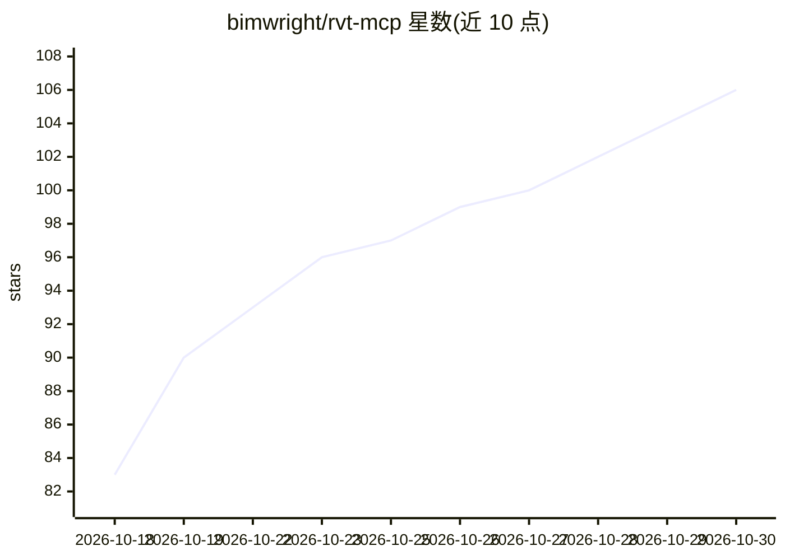

# bimwright/rvt-mcp

⭐ 106 · C# · Apache-2.0 · 推送 2026-10-23 · [GitHub](https://github.com/bimwright/rvt-mcp) · [官网](https://github.com/bimwright/rvt-mcp) · 组织维护 · 中文 README

**面向 AI agent 的 Revit 本地 MCP 工具网关（Revit 2022–2027）**

本地 MCP 网关：.NET 8 服务器经 stdio 与 MCP 客户端通信，按年份（2022–2027）分发的 Revit 加载项通过 localhost TCP（≤2024）或命名管道（≥2025）与服务器连接，数据不离开本机。为 agent 提供类型化工具面（完整目录 237 个工具，覆盖查询、创建、视图、导出、MEP、结构等 20+ 工具集）、C# 逃逸通道（send_code），以及把重复模式固化为个人工具的 ToolBaker。安装走 PowerShell 安装器或由 agent 代装，可注册到 Claude Desktop/Claude Code 等客户端；Family Editor 授权暂不在范围内。作者自述为早期版本。

## 筛选速览

| 维度 | 判定 | 备注 |
|---|---|---|
| AI 角色 | `ai-ecosystem` | LLM/agent 周边工具 |
| 许可风险 | `permissive` | Apache-2.0 |
| 部署形态 | `desktop` | 安装包/桌面程序 |
| 模型依赖 | — | README 未给出锁定关系 |
| 硬件要求 | — | 无带数字的原话,不猜 |
| 安装摩擦 | `medium` | 含编译或系统依赖之一 |
| 成熟度 | `idea` | |

## 能力要点

- stdio MCP 服务器 + Revit 年份加载项的本地桥接，数据不出机器
- 完整目录 237 个工具、20+ 工具集（query/create/view/export/MEP/structural 等）
- revit_send_code_to_revit 可在 Revit 内编译运行 C#，无需 Visual Studio
- ToolBaker 可将重复调用模式固化为个人工具

## 适用场景

- 让 Claude 等 MCP 客户端中的 agent 读写运行中的 Revit 模型
- 通过自然语言驱动 Revit 做建模、出图、导出与碰撞检查等操作
- 把项目里反复出现的手工流程沉淀为可复用的个人工具

## 场景标签

 · 领域:建筑/工程（AEC）· BIM 自动化

## 证据(README 行号)

> L5:  MCP gateway for Autodesk Revit — local tools for agents, optional personal bake loop
> L20: `rvt-mcp` is a **local** bridge between an MCP client and a running Revit session. A .NET 8 server talks MCP over s

## 星数曲线

2026-10-18 83 → 2026-10-30 106（+23）

---
*卡片 v1 · prompt 1.4 · 生成 2026-10-23 · 置信度 high · 依据 README sha `17ee96f12145` · [字段定义](../../DATASET.md)*
