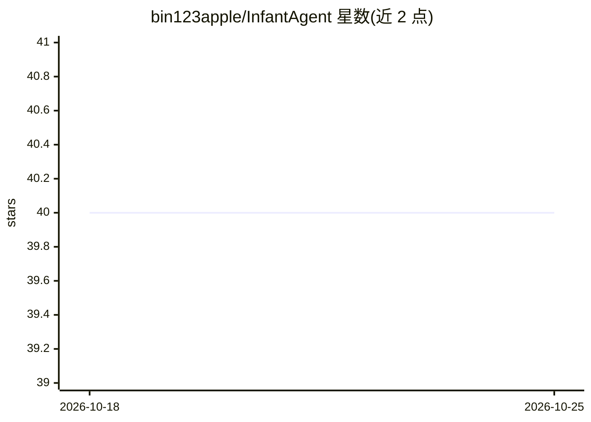

# bin123apple/InfantAgent

⭐ 40 · Python · Apache-2.0 · 推送 2026-09-12 · [GitHub](https://github.com/bin123apple/InfantAgent) · 个人维护

**多模态 PC 操控 agent：自主操作鼠标与屏幕交互**

NeurIPS 2025 论文项目 InfantAgent：构建能以多模态方式操控自身 PC 的 agent，可自主控制鼠标点击屏幕任意位置，而非仅依赖浏览器分析决策；默认使用 UI-TARS-1.5 7B 作视觉定位模型，通过 Docker 容器内的 Linux 桌面（Guacamole 共享）运行，浏览器工具改自 browser-use，容器配置基于 OpenHands。作者声明尚未在 benchmark 之外做大规模测试。仅测试于带 NVIDIA Tesla GPU 的 Linux 服务器，Mac/Windows 可能有 bug。

## 筛选速览

| 维度 | 判定 | 备注 |
|---|---|---|
| AI 角色 | `ai-native` | 本体是模型或模型工具 |
| 许可风险 | `permissive` | Apache-2.0 |
| 部署形态 | `self-host` | docker 或自建部署 |
| 模型依赖 | locked-api |  |
| 硬件要求 | — | 无带数字的原话,不猜 |
| 安装摩擦 | `low` | 无编译、无系统依赖或容器化 |
| 成熟度 | `idea` | |

## 能力要点

- 自主鼠标操控与屏幕点击的多模态交互
- 默认 UI-TARS-1.5 7B 视觉定位模型
- Docker 容器内 Linux 桌面 + Guacamole 桌面共享
- 浏览器工具基于 browser-use 修改

## 适用场景

- 让 agent 直接操控图形桌面完成电脑任务
- 作为后续 agent 强化学习训练的系统
- 复现论文中的自动化计算机交互实验

## 场景标签

`GUI 自动化` · 领域:效率与自动化

## 证据(README 行号)

> L7:  InfantAgent: A multimodal agent that can interact with its own PC in a multimodal manner.
> L24: 1. To build a multimodal agent that can interact with its own PC in a multimodal manner. This means it can autonomo

## 星数曲线

2026-10-18 40 → 2026-10-25 40（+0）

---
*卡片 v1 · prompt 1.4 · 生成 2026-10-25 · 置信度 high · 依据 README sha `3bce04821b8e` · [字段定义](../../DATASET.md)*
