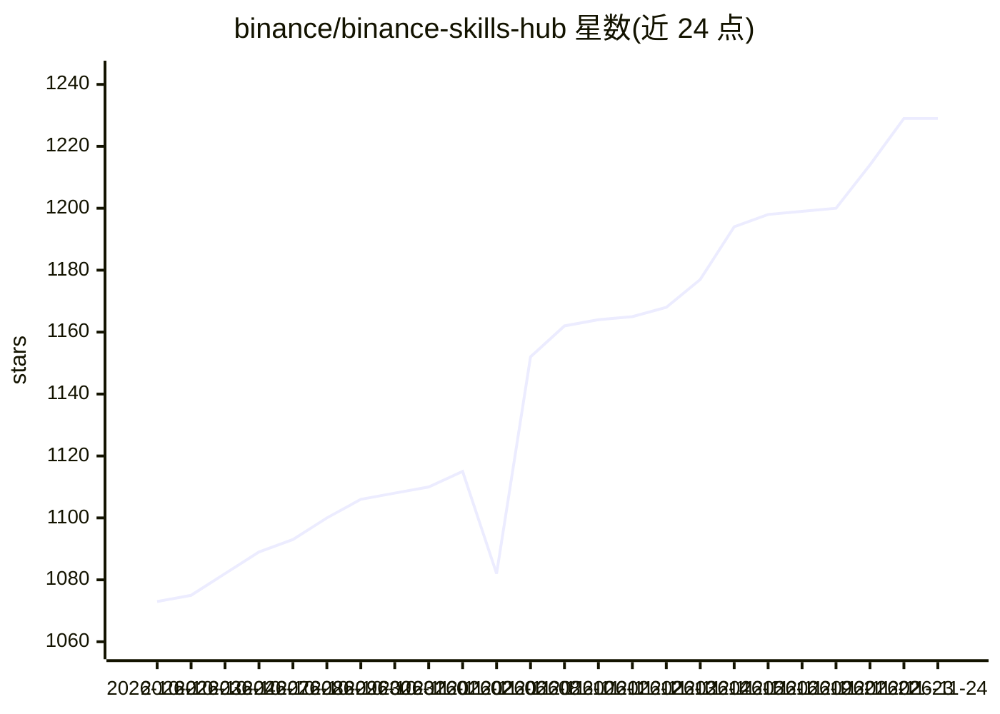

# binance/binance-skills-hub

⭐ 1,230 · Python · 推送 2026-11-12 · [GitHub](https://github.com/binance/binance-skills-hub) · 组织维护

**币安的 AI agent 加密技能市场：搜索/交易/钱包/DeFi**

由 Binance 维护的开源技能市场，每个技能以独立文件夹中的 SKILL.md（YAML frontmatter + 结构化指令）形式组织，覆盖代币搜索、交易执行、钱包追踪、信号监控与 DeFi 协议交互。声明面向整个加密生态：任意 agent、任意框架、任意链均可通过少量配置接入，给出 LangChain、CrewAI、OpenClaw、Claude Code 等兼容环境说明。安装通过 npx 单命令完成，需 Node.js 22+，Binance 部分端点需配置 API 凭证并建议最小权限与 IP 白名单。README 附免责声明，说明输出仅为信息性内容、不构成投资建议。

## 筛选速览

| 维度 | 判定 | 备注 |
|---|---|---|
| AI 角色 | `ai-knowledge` | 知识聚合/清单类 |
| 许可风险 | `none` | — |
| 部署形态 | `library` | 以包/库形式分发 |
| 模型依赖 | — | README 未给出锁定关系 |
| 硬件要求 | — | 无带数字的原话,不猜 |
| 安装摩擦 | `low` | 无编译、无系统依赖或容器化 |
| 成熟度 | — | 结构信号不足 |

## 能力要点

- 技能以 SKILL.md（YAML frontmatter + 结构化指令）形式组织，可由社区通过 PR 贡献
- npx skills add 单命令安装，兼容 OpenClaw、Claude Code 等多种 agent
- 面向任意 agent、任意框架、任意链，声明不限于 Binance 产品
- 提供 API 凭证配置指引并建议最小权限与 IP 白名单

## 适用场景

- 让 AI agent 通过自然语言搜索代币与执行交易
- 让 agent 追踪钱包与监控市场信号
- 让 agent 与 DeFi 协议交互

## 场景标签

`金融量化` `Agent 框架` · 领域:Agent 开发

## 证据(README 行号)

> L11: Each skill lives in its own folder and contains a `SKILL.md` file with YAML frontmatter and structured instructions
> L17: Get started with Binance Skills Hub in a single command. Works with various agents such as OpenClaw and Claude Code
> L30: npx skills add https://github.com/binance/binance-skills-hub

## 星数曲线

2026-10-22 1,073 → 2026-11-24 1,229（+156）

---
*卡片 v1 · prompt 1.4 · 生成 2026-11-23 · 置信度 high · 依据 README sha `2212eaf9d25a` · [字段定义](../../DATASET.md)*
