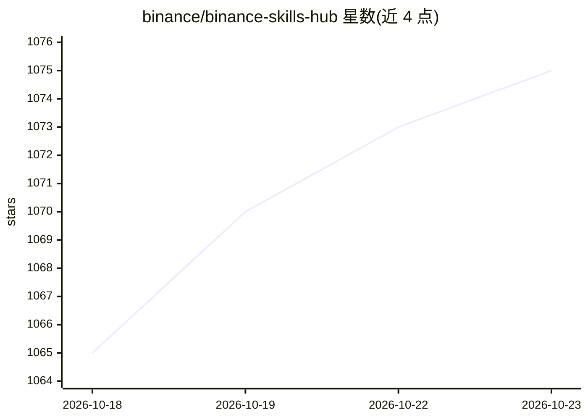

# binance/binance-skills-hub

⭐ 1,075 · Python · 推送 2026-10-20 · [GitHub](https://github.com/binance/binance-skills-hub) · 组织维护

**Binance 维护的加密货币 AI agent 技能市场：让 agent 用自然语言操作链上与交易所**

由 Binance 维护的开源技能集合：每个技能为独立文件夹内的 SKILL.md（YAML frontmatter+结构化指令），使 LangChain、CrewAI、OpenClaw、Claude Code 等 agent 通过自然语言执行代币搜索、交易、钱包追踪、信号监控与 DeFi 协议交互，覆盖中心化与去中心化场景。通过 npx skills add 一行命令安装，需 Node.js 22+；部分 Binance 技能需配置 API 凭证（环境变量/secrets 文件）。README 附有完整投资风险免责声明。

## 筛选速览

| 维度 | 判定 | 备注 |
|---|---|---|
| AI 角色 | `ai-ecosystem` | LLM/agent 周边工具 |
| 许可风险 | `none` | — |
| 部署形态 | `library` | 以包/库形式分发 |
| 模型依赖 | — | README 未给出锁定关系 |
| 硬件要求 | — | 无带数字的原话,不猜 |
| 安装摩擦 | `low` | 无编译、无系统依赖或容器化 |
| 成熟度 | — | 结构信号不足 |

## 能力要点

- 每个技能为独立 SKILL.md（YAML frontmatter + 结构化指令）
- 支持任意 agent 框架（LangChain/CrewAI/OpenClaw/Claude Code）接入 CEX 与 DeFi
- npx skills add 单命令安装，Node.js 22+ 为前置条件
- Binance 技能部分端点需 API 凭证（.env / .openclaw/secrets.env / 对话传入）

## 适用场景

- 让我的 AI agent 用自然语言查询代币与执行交易
- 追踪钱包、监控加密市场信号
- 为自建 agent 栈接入 DeFi 协议操作能力

## 场景标签

`金融量化` · 领域:学习与行业

## 证据(README 行号)

> L3: Binance Skills Hub is an open skills marketplace that gives AI agents native access to crypto: both centralized and 
> L7: We're not building this just for Binance products. Skills Hub is designed for the entire crypto ecosystem: any agent

## 星数曲线

2026-10-18 1,065 → 2026-10-23 1,075（+10）

---
*卡片 v1 · prompt 1.4 · 生成 2026-10-21 · 置信度 high · 依据 README sha `140d5c493a5d` · [字段定义](../../DATASET.md)*
