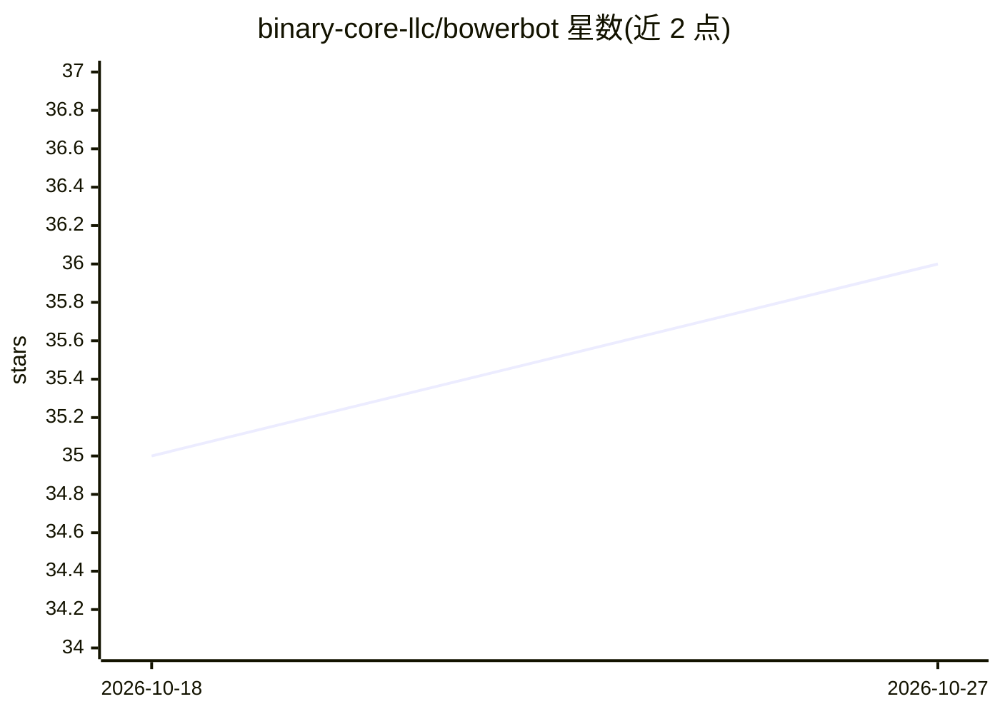

# binary-core-llc/bowerbot

⭐ 36 · Python · Apache-2.0 · 推送 2026-10-26 · [GitHub](https://github.com/binary-core-llc/bowerbot) · [官网](https://binarycore.us/bowerbot) · 组织维护

**AI agent：从自然语言组装可投产的 OpenUSD 场景**

面向使用 OpenUSD 管线的团队（VFX、AEC、仿真、数字孪生、机器人、电商 3D）的对话式 USD 场景组装代理：从 Sketchfab、本地磁盘、企业 DAM 等来源查找资产，按 ASWF 规范做带空间感知的摆放、材质绑定、原生 USD 灯光、单位/层级/引用校验，并打包为 USDZ 供各 USD 运行时使用。两种运行模式：agent 模式自带 LLM（OpenAI/Anthropic/litellm），MCP 模式作为工具由 Claude Desktop、Cursor 等客户端驱动。README 声明其非最终场景生成器、不替代 Maya/Omniverse 等 DCC 工具，产出场景需在 DCC 中审阅与精修。以 Python 包提供，通过 uv/pip 安装。

## 筛选速览

| 维度 | 判定 | 备注 |
|---|---|---|
| AI 角色 | `ai-native` | 本体是模型或模型工具 |
| 许可风险 | `permissive` | Apache-2.0 |
| 部署形态 | `desktop` | 安装包/桌面程序 |
| 模型依赖 | — | README 未给出锁定关系 |
| 硬件要求 | — | 无带数字的原话,不猜 |
| 安装摩擦 | `low` | 无编译、无系统依赖或容器化 |
| 成熟度 | — | 结构信号不足 |

## 能力要点

- 从多来源（Sketchfab/本地/DAM）发现资产并做空间感知摆放、材质绑定与原生 USD 灯光
- 入口与组装时强制 ASWF 资产规范校验（单位、defaultPrim、循环引用等）
- USDZ 打包，含 Apple AR Quick Look 严格子集预校验选项
- 可插拔 skills 扩展资产来源，多 LLM 支持（OpenAI/Anthropic/litellm）

## 适用场景

- 用自然语言把空场景快速搭成可投产的 USD stage
- 在 DCC 中继续精修前先由代理完成场景 blockout 与技术校验
- 为电商 3D、数字孪生、机器人仿真等 USD 管线批量组装与打包场景
- 通过 MCP 客户端（Claude Code/Cursor）把场景组装接入现有工作流

## 场景标签

 · 领域:3D 图形/OpenUSD 管线

## 证据(README 行号)

> L24: BowerBot is an **AI agent for OpenUSD**, a conversational interface that helps any team using OpenUSD go from an em
> L78: - 🧠 **Multi-LLM support**: OpenAI, Anthropic, and any provider via litellm
> L145: - **Agent mode**: BowerBot thinks for itself using the LLM key. Good for running standalone or as a product: `bowe

## 星数曲线

2026-10-18 35 → 2026-10-27 36（+1）

---
*卡片 v1 · prompt 1.4 · 生成 2026-10-25 · 置信度 mid · 依据 README sha `f25c33e9b486` · [字段定义](../../DATASET.md)*
