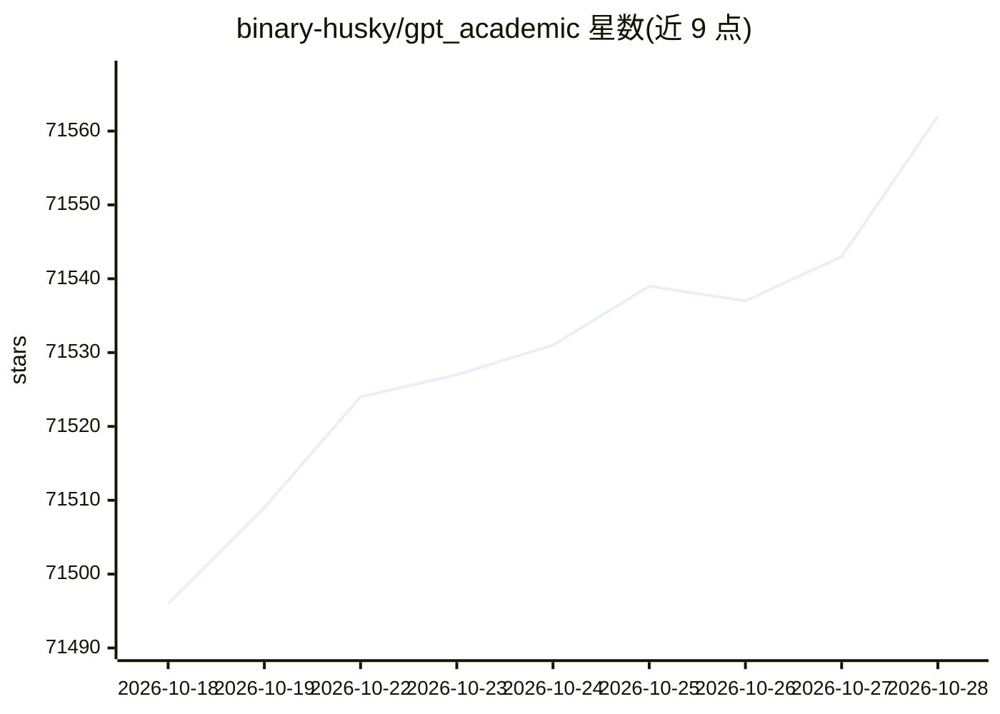

# binary-husky/gpt_academic

⭐ 71,568 · Python · GPL-3.0 · 推送 2026-01-25 · [GitHub](https://github.com/binary-husky/gpt_academic) · [官网](https://github.com/binary-husky/gpt_academic/wiki/online) · 个人维护 · 中文 README

**为学术用户提供LLM交互接口，优化论文阅读润色写作**

一个面向学术场景的LLM交互前端，围绕论文阅读/润色/写作提供插件化功能：LaTeX/PDF论文翻译与总结、arxiv论文精细翻译、语法校对、代码项目剖析与自译解、批量注释生成等。支持通过functional.py动态生成自定义按钮与热更新函数插件，可并行问询多种模型，支持多API-key负载均衡与本地模型后端（ChatGLM/MOSS/RWKV）。Windows/Linux/macOS可直接运行，另提供Docker与一键脚本部署。

## 筛选速览

| 维度 | 判定 | 备注 |
|---|---|---|
| AI 角色 | `ai-enhanced` | 去掉 AI 部分产品仍成立 |
| 许可风险 | `viral` | GPL-3.0 |
| 部署形态 | `self-host` | docker 或自建部署 |
| 模型依赖 | — | README 未给出锁定关系 |
| 硬件要求 | — | 无带数字的原话,不猜 |
| 安装摩擦 | `low` | 无编译、无系统依赖或容器化 |
| 成熟度 | — | 结构信号不足 |

## 动量与使用信号

- 维护:`declining` — 距上次 push 265.8 天,年发版 0,100 位贡献者
- 涨星:近 1 天 **+9**(自 20261016 起算)
- 下载:GitHub Release 附件 累计 73,705(32 个 release)

## 能力要点

- 一键解读/翻译latex与pdf论文并生成摘要，支持arxiv精细翻译
- 虚空终端：用自然语言调度本项目其他插件
- 插件支持热更新，按钮由functional.py动态生成可自定义
- 多LLM并行问询，多API-key共存与负载均衡

## 适用场景

- 阅读英文论文时一键翻译全文并生成摘要
- 润色和校对LaTeX论文并输出对照PDF
- 让GPT剖析整个代码工程并生成解读报告
- 同时接入多家国内大模型 API 做对比问询

## 场景标签

`文档问答` `AI 写作` `聊天机器人` · 领域:对话与助手

## 证据(README 行号)

> L12:  GPT 学术优化 (GPT Academic)
> L32: 功能（⭐= 近期新增功能） | 描述
> L43: 读论文、翻译论文 | [插件] 一键解读latex/pdf论文全文并生成摘要

## 星数曲线

2026-10-18 71,496 → 2026-10-28 71,562（+66）

---
*卡片 v1 · prompt 1.4 · 生成 2026-10-18 · 置信度 mid · 依据 README sha `fba6f8bd3e21` · [字段定义](../../DATASET.md)*
