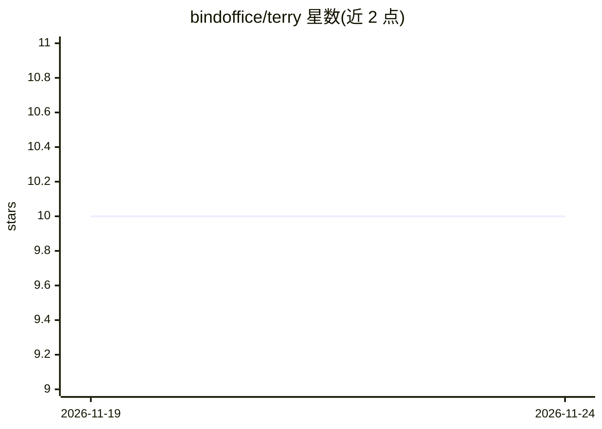

# bindoffice/terry

⭐ 10 · Rust · NOASSERTION · 推送 2026-11-19 · [GitHub](https://github.com/bindoffice/terry) · [官网](https://bindoffice.github.io/terry/) · 个人维护

**面向 AI 编码代理的多终端工作区，垂直标签+侧栏 Agent**

基于 gpui 的跨平台终端，将终端组织为工作区：多终端分组、平铺布局、广播输入、会话恢复与后台守护进程持久会话；支持 SSH/tmux 集成、shell integration、CLI 与 IPC 自动化 API、插件（kittens）机制、图像协议与配色方案库。AI 部分：内置编码代理 tom、侧栏 LLM 对话面板（可配置 profiles 执行命令与工具）、通过屏幕底部检测各编码代理的运行状态，并支持 MCP 服务器扩展 agent 能力。面向以命令行为主要工作方式的用户。

## 筛选速览

| 维度 | 判定 | 备注 |
|---|---|---|
| AI 角色 | `ai-enhanced` | 去掉 AI 部分产品仍成立 |
| 许可风险 | `none` | NOASSERTION |
| 部署形态 | `None` |  |
| 模型依赖 | — | README 未给出锁定关系 |
| 硬件要求 | — | 无带数字的原话,不猜 |
| 安装摩擦 | `low` | 无编译、无系统依赖或容器化 |
| 成熟度 | — | 结构信号不足 |

## 能力要点

- 内置编码代理 tom，终端内直接启动，无需单独安装
- 侧栏 AI Agent 面板，可运行命令与工具，支持 MCP 服务器接入
- 检测 14+ 种编码代理的 working/blocked/idle 状态并可等待状态变化
- 分组平铺布局、广播输入、CLI/JSON API 自动化与会话模板

## 适用场景

- 同时运行多个 AI 编码代理并跟踪各自状态
- 用脚本和编辑器通过 CLI/HTTP API 驱动终端操作
- 通过 SSH/tmux 在远程主机上保持集成的开发工作区

## 场景标签

`编码 Agent` · 领域:编码与开发

## 证据(README 行号)

> L5: **Terry** turns your terminal into a workspace.
> L34: - **Built-in coding agent** — tom ships inside Terry: type `tom` in any terminal to get a full terminal coding agen
> L36: - **MCP** — Connect Model Context Protocol servers to extend agent capabilities

## 星数曲线

2026-11-19 10 → 2026-11-24 10（+0）

---
*卡片 v1 · prompt 1.4 · 生成 2026-11-20 · 置信度 high · 依据 README sha `8e45bcd10d44` · [字段定义](../../DATASET.md)*
