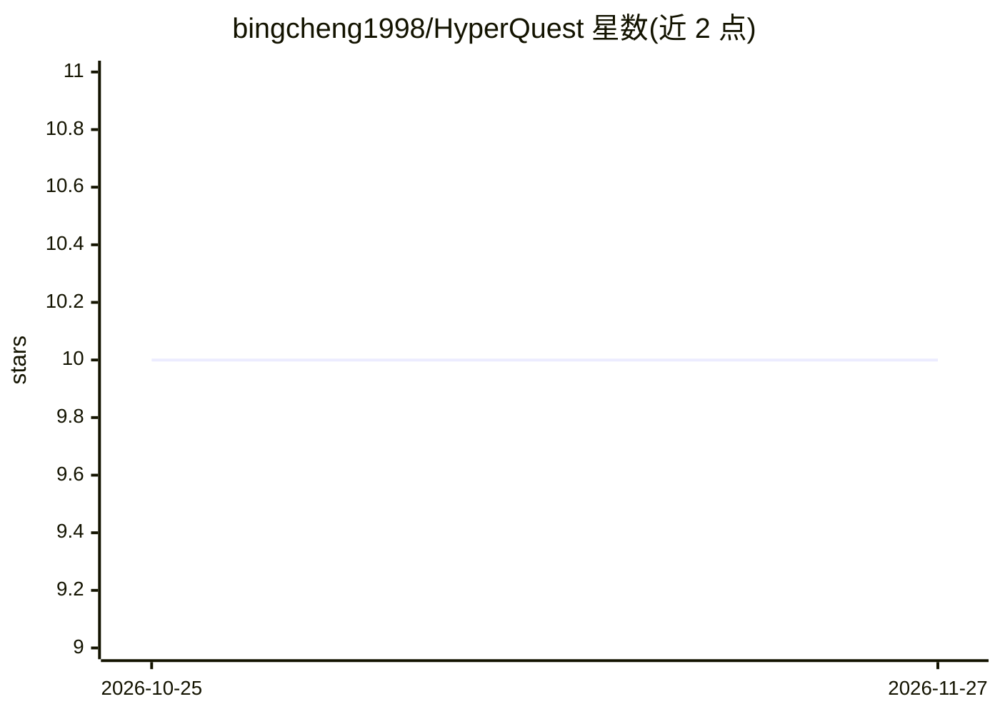

# bingcheng1998/HyperQuest

⭐ 10 · Jupyter Notebook · 推送 2026-01-11 · [GitHub](https://github.com/bingcheng1998/HyperQuest) · 个人维护 · 中文 README

**帮 ML 初学者建立超参数选择直觉的教学网页应用**

仿斯坦福 CS231n 的 HyperQuest 项目：一个网页应用，让机器学习初学者在浏览器中调整超参数并观察训练/验证准确率曲线与损失曲线，从而理解各超参数的作用。提供两层网络与卷积网络两种版本，支持通过 HTML 锚点加一段 script 标签嵌入第三方网页，模型脚本以 JS 形式托管在 bingcheng.openmc.cn 上，托管版本部署在 GitHub Pages，含 404 页面与分享 meta 标签，README 无本地安装与运行说明。

## 筛选速览

| 维度 | 判定 | 备注 |
|---|---|---|
| AI 角色 | `ai-native` | 本体是模型或模型工具 |
| 许可风险 | `none` | — |
| 部署形态 | `None` |  |
| 模型依赖 | — | README 未给出锁定关系 |
| 硬件要求 | — | 无带数字的原话,不猜 |
| 安装摩擦 | `low` | 无编译、无系统依赖或容器化 |
| 成熟度 | — | 结构信号不足 |

## 能力要点

- 网页内交互调整超参数并可视化准确率与损失曲线
- 提供 Two Layer Net 与 Conv Neural Net 两个版本
- 通过一段 script 标签即可将工具嵌入任意网页
- 托管于 GitHub Pages，浏览器直接访问

## 适用场景

- 初学 ML 时直观感受学习率等超参数对训练的影响
- 教学或博客页面中嵌入超参数调参演示
- 理解训练/验证曲线形态的含义

## 场景标签

`教程课程` · 领域:学习与行业

## 证据(README 行号)

> L4: HyperQuest is a web-app used by beginners in Machine Learning to easily get a proper intuition for choosing the righ
> L53: ## 1. Two Layer Net
> L60: https://bingcheng.openmc.cn/HyperQuest/

## 星数曲线

2026-10-25 10 → 2026-11-27 10（+0）

---
*卡片 v1 · prompt 1.4 · 生成 2026-11-19 · 置信度 high · 依据 README sha `214a8f2c829e` · [字段定义](../../DATASET.md)*
