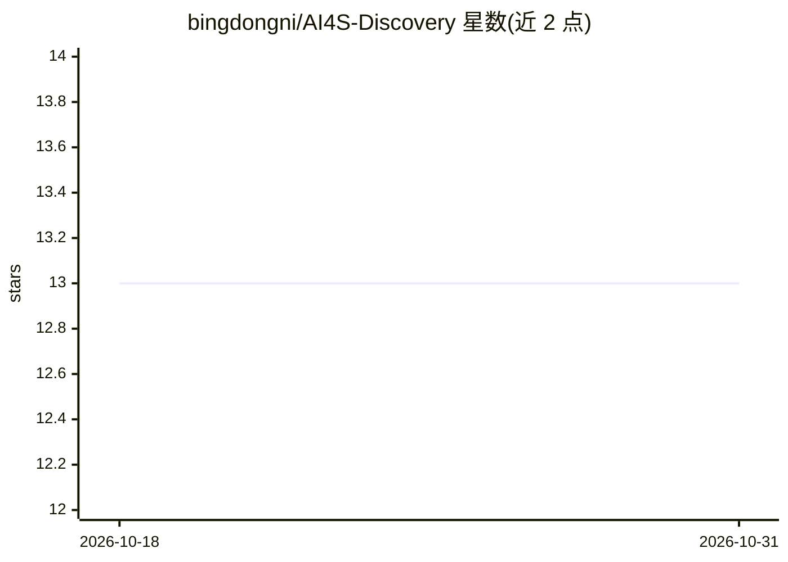

# bingdongni/AI4S-Discovery

⭐ 13 · Python · NOASSERTION · 推送 2026-04-19 · [GitHub](https://github.com/bingdongni/AI4S-Discovery) · 个人维护 · 中文 README

**面向科研人员的多智能体科研创新辅助工具**

基于多智能体架构（搜索、分析、关联、评估、生成智能体）的科研工具：从 arXiv、PubMed、Semantic Scholar 等数据源聚合文献，用 NetworkX 构建引用知识图谱（Louvain 社区检测、中心性分析），做 TRL 1-9 级技术成熟度评估，并基于 OpenAI GPT 或本地 MiniCPM 模型通过反事实推理生成创新假设与跨域迁移推荐。提供 Web 界面、RESTful API 与 Python SDK；无 API 密钥时自动降级为模拟模式。支持 Windows 本地部署与 Docker，报告输出 Markdown/HTML。

## 筛选速览

| 维度 | 判定 | 备注 |
|---|---|---|
| AI 角色 | `ai-native` | 本体是模型或模型工具 |
| 许可风险 | `none` | NOASSERTION |
| 部署形态 | `self-host` | docker 或自建部署 |
| 模型依赖 | — | README 未给出锁定关系 |
| 硬件要求 | — | 无带数字的原话,不猜 |
| 安装摩擦 | `low` | 无编译、无系统依赖或容器化 |
| 成熟度 | — | 结构信号不足 |

## 能力要点

- 多智能体协同：搜索/分析/关联/评估/生成
- TRL 1-9 级多方法融合成熟度评估
- LLM 驱动的创新假设生成与反事实推理
- 多源文献聚合与 NetworkX 知识图谱构建

## 适用场景

- 输入研究需求，自动完成文献检索、图谱、TRL 评估到创新假设的全流程
- 评估某研究方向的成熟度并生成技术路线图
- 获取跨领域方法迁移的推荐方案

## 场景标签

`多智能体` `知识图谱` `科研工具` · 领域:Agent 开发

## 证据(README 行号)

> L7: **AI4S-Discovery** 是一款基于多智能体架构的科研创新辅助工具，专为科研人员设计，能够自动化完成文献挖掘、研究脉络分析、技术成熟度评估和创新假设生成等全流程任务。
> L14: - **LLM驱动的创新假设生成**：集成OpenAI GPT和本地MiniCPM模型，通过反事实推理生成创新假设
> L19: - **多智能体架构**：搜索、分析、关联、评估、生成智能体协同工作

## 星数曲线

2026-10-18 13 → 2026-10-31 13（+0）

---
*卡片 v1 · prompt 1.4 · 生成 2026-10-31 · 置信度 high · 依据 README sha `76745522fe81` · [字段定义](../../DATASET.md)*
