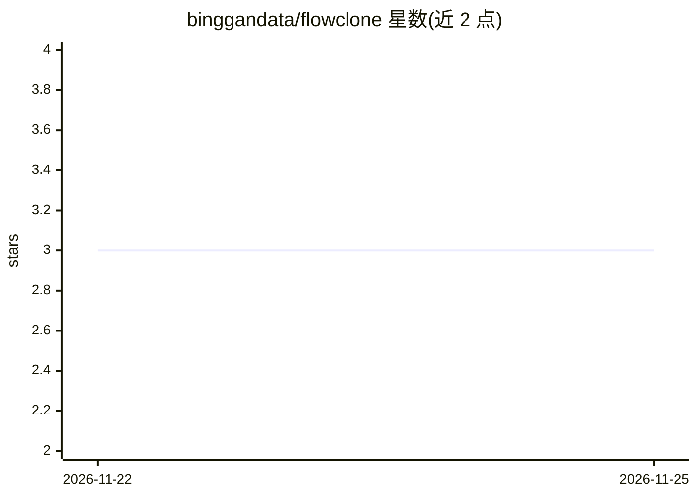

# binggandata/flowclone

⭐ 3 · Kotlin · MIT · 推送 2026-11-20 · [GitHub](https://github.com/binggandata/flowclone) · 个人维护 · 中文 README

**净室复刻 Google Flow 的安卓视频生成 App 教学项目**

以净室方式复刻 Google Flow 安卓应用的完整示例工程：Kotlin/Compose 原生客户端 + Python stdlib/SQLite 自建 BFF 服务端 + 可替换的 AI 生成网关接入。功能覆盖账号体系、图片/视频生成与编辑延长、素材管理、点数计费、任务通知，Agent 聊天经服务端转发 LLM。网关 Key 仅存服务端，仓库不含可用 Key，仅限个人学习用途，缺支付、真机推送等商业化组件。

## 筛选速览

| 维度 | 判定 | 备注 |
|---|---|---|
| AI 角色 | `ai-native` | 本体是模型或模型工具 |
| 许可风险 | `permissive` | MIT |
| 部署形态 | `None` |  |
| 模型依赖 | — | README 未给出锁定关系 |
| 硬件要求 | — | 无带数字的原话,不猜 |
| 安装摩擦 | `medium` | 含编译或系统依赖之一 |
| 成熟度 | `idea` | |

## 能力要点

- 净室复刻方法论 skill（skills/bggg-copy-app）可复用
- 生成任务全链路：submit→job 映射→轮询→缓存→下载，支持失败重试与中断恢复
- 网关 Key 仅存服务端，支持 OpenAI 兼容或 NGSFlow 协议
- 附带复盘文档、UI 规格、逐屏差异表与上架材料模板

## 适用场景

- 学习如何自建 BFF 服务端代理 AI 图像/视频生成
- 参考 Compose 客户端的账号、计费与任务状态实现
- 按净室流程复刻一款现有 App 的交互与工程结构

## 场景标签

`视频生成` `图像生成` `教程课程` · 领域:内容生成

## 证据(README 行号)

> L3: > 一个**净室（clean-room）复刻** Google Flow 安卓 App 的完整示例：原生 Kotlin/Compose 客户端 + 自建 BFF Server + AI 生成后端接入 + 复刻方法论 skill。
> L9: - 生成：图片/视频（经自建 Server 代理 NGSFlow Gateway，Key 不落端）、多份生成、编辑、延长
> L22: │ FlowClone Android App│  HTTP  │  flowclone-server (BFF) │  HTTP  │  NGSFlow AI Gateway   │

## 星数曲线

2026-11-22 3 → 2026-11-25 3（+0）

---
*卡片 v1 · prompt 1.4 · 生成 2026-11-22 · 置信度 high · 依据 README sha `11a9656c84d3` · [字段定义](../../DATASET.md)*
