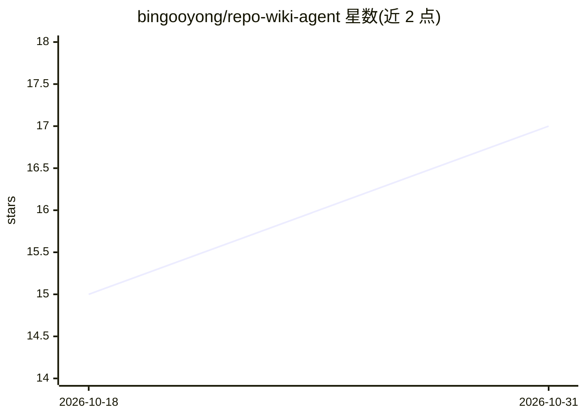

# bingooyong/repo-wiki-agent

⭐ 17 · Python · Apache-2.0 · 推送 2026-10-27 · [GitHub](https://github.com/bingooyong/repo-wiki-agent) · 个人维护 · 中文 README

**为任意代码仓库生成结构化 Wiki 文档的本地优先 Python CLI**

面向开发者的仓库文档生成工具：通过 LLM（默认 OpenAI 兼容接口，支持 Anthropic 配置）为代码工程生成结构化 Wiki，输出隔离到 .repo-agent-eval/ 目录不污染目标仓库，或以 standard 模式直接写入 docs/。核心机制包括基于 git diff 的增量更新、SQLite+FTS 全文检索（ChromaDB 可选作语义向量存储，未装时降级为 JSON）、13 项 Strict Verify 质量门禁（prose 密度、引用、Mermaid 图、API 聚合质量等），只有通过门禁才发布 READY release。附带 VS Code/Cursor 浏览插件（TypeScript，不直接调用 LLM）与 Codex skills-only 插件。限制：插件不内嵌 Python，需先安装 CLI 并执行 release-publish 才能浏览 Wiki。

## 筛选速览

| 维度 | 判定 | 备注 |
|---|---|---|
| AI 角色 | `ai-native` | 本体是模型或模型工具 |
| 许可风险 | `permissive` | Apache-2.0 |
| 部署形态 | `library` | 以包/库形式分发 |
| 模型依赖 | — | README 未给出锁定关系 |
| 硬件要求 | — | 无带数字的原话,不猜 |
| 安装摩擦 | `low` | 无编译、无系统依赖或容器化 |
| 成熟度 | — | 结构信号不足 |

## 能力要点

- qoder-like 隔离输出模式：run 与 READY release 分离，不污染目标仓库
- 13 项 Strict Verify 质量门禁（HARD/SOFT），仅发布通过门禁的产物
- 基于 git diff 的页面级增量失效与选择性重生成
- SQLite+FTS 本地检索必有，ChromaDB 可选、缺失时降级 vectors.json

## 适用场景

- 为已有代码仓库自动生成结构化 Wiki 文档
- 在 CI 中运行 repo-wiki verify --ci 做文档质量门禁
- 在 VS Code/Cursor 侧栏浏览和维护生成的 Wiki

## 场景标签

`AI 写作` · 领域:内容生成

## 证据(README 行号)

> L3: **Local-first repository wiki generator** — 无需 `.qoder` 目录即可为任意工程生成结构化 Wiki 文档。
> L51: 无 YAML 时默认 `provider=openai`、`model=gpt-4o-mini`。要用 Anthropic 请在 YAML 里显式写 `provider: anthropic`。
> L150: |`repo-wiki generate [--profile qoder-like]`|生成 Wiki 文档|

## 星数曲线

2026-10-18 15 → 2026-10-31 17（+2）

---
*卡片 v1 · prompt 1.4 · 生成 2026-10-30 · 置信度 mid · 依据 README sha `f03c3ac94244` · [字段定义](../../DATASET.md)*
