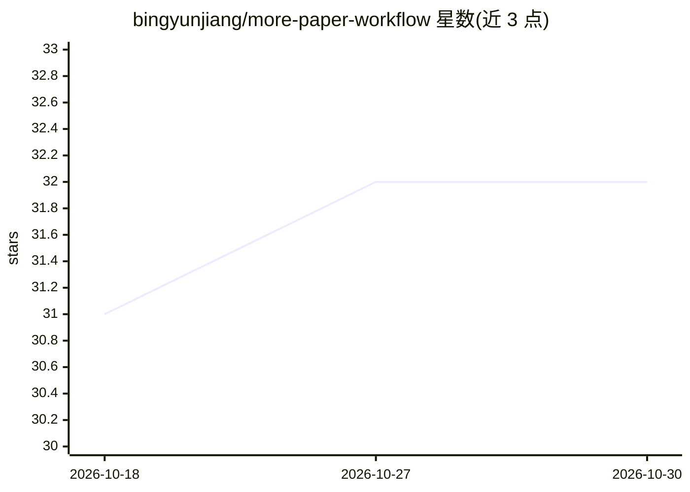

# bingyunjiang/more-paper-workflow

⭐ 32 · Python · NOASSERTION · 推送 2026-08-14 · [GitHub](https://github.com/bingyunjiang/more-paper-workflow) · 个人维护 · 中文 README

**面向中文/双语论文的八步证据闭环 AI 写作工作流 Skill**

以 SKILL.md 形式交付的学术论文工作流：把定题、大纲、检索方案、检索评分、PDF 下载路由、Zotero 对齐、证据化写作与引用审计、保守润色连成八步可追溯链路，由支持 Skill 的运行时（Claude Code、Codex、Hermes、OpenClaw）加载执行。支持任意 Step 直达但不跳过证据边界、Checkpoint 与 Completion Gate；区分元数据/摘要/全文证据等级，RAG 仅作候选定位不替代原文确认。安装方式是把仓库地址交给 Skill 运行时，另提供 pip 依赖清单与离线 Zotero 缓存方案。

## 筛选速览

| 维度 | 判定 | 备注 |
|---|---|---|
| AI 角色 | `ai-native` | 本体是模型或模型工具 |
| 许可风险 | `none` | NOASSERTION |
| 部署形态 | `library` | 以包/库形式分发 |
| 模型依赖 | — | README 未给出锁定关系 |
| 硬件要求 | — | 无带数字的原话,不猜 |
| 安装摩擦 | `low` | 无编译、无系统依赖或容器化 |
| 成熟度 | — | 结构信号不足 |

## 能力要点

- Step 1-8 全链路工件：从研究主题.md 到润色稿与修订台账
- 弱证据不支撑强 claim 的分级规则（metadata_only/abstract_only/全文核验）
- 任意 Step 直达入口，但 Checkpoint 与 Completion Gate 不被跳过
- 原生论文流程图引擎输出语义 SVG、PNG、布局检查与证据哈希

## 适用场景

- 已有 DOI/BibTeX 时直达 Step 5 批量路由下载 PDF
- 基于 Zotero 子集合逐节做证据化写作与引用审计
- 对已有稿件做不漂移含义的保守润色修订
- 为研究方向收敛研究问题、范围与可证伪条件

## 场景标签

`科研工具` `AI 写作` · 领域:内容生成

## 证据(README 行号)

> L15:  more-paper-workflow：AI 写论文，先跑通证据链。八步论文工作流支持任意步骤直达、证据追溯与质量门核验
> L85: 把仓库地址交给支持 Skill 的 Codex、Claude Code、Hermes 或 OpenClaw：
> L213: ```text

## 星数曲线



2026-10-18 31 → 2026-10-30 32（+1）


---
*卡片 v1 · prompt 1.4 · 生成 2026-10-26 · 置信度 high · 依据 README sha `c7578696f20d` · [字段定义](../../DATASET.md)*
