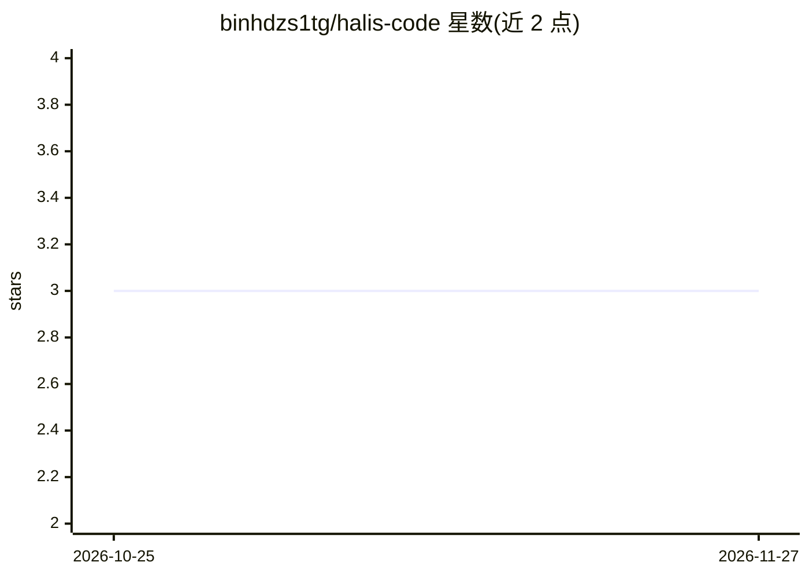

# binhdzs1tg/halis-code

⭐ 3 · TypeScript · NOASSERTION · 推送 2026-11-24 · [GitHub](https://github.com/binhdzs1tg/halis-code) · [官网](https://www.npmjs.com/package/halis-code) · 个人维护

**带防护栏的终端/桌面双形态编码 Agent 工具**

Halis Code 是一个编码 Agent，流式读取、编辑并运行用户项目中的代码。其核心机制围绕长会话防护：token 超限时的安全压缩（不切断工具调用与结果）、重复调用守卫（3/5/8 次递进提醒、12 次硬停）、危险命令需带原因说明的审批、超长工具输出溢出到文件而非截断。提供 npm 安装的 Ink 终端界面与 Electron 桌面应用两种形态，内置 models.dev 目录（200+ provider、8000+ 模型）支持 OpenAI 与 Anthropic 两种协议，桌面版附带 mcp 客户端、子代理与 key 保险库。MIT 许可，跨 macOS/Linux/Windows。

## 筛选速览

| 维度 | 判定 | 备注 |
|---|---|---|
| AI 角色 | `ai-ecosystem` | LLM/agent 周边工具 |
| 许可风险 | `none` | NOASSERTION |
| 部署形态 | `desktop` | 安装包/桌面程序 |
| 模型依赖 | local-ok | 支持本地模型 |
| 硬件要求 | — | 无带数字的原话,不猜 |
| 安装摩擦 | `low` | 无编译、无系统依赖或容器化 |
| 成熟度 | — | 结构信号不足 |

## 能力要点

- 压缩、重复守卫、审批、输出溢出四类长会话防护机制
- 终端 Ink TUI 与 Electron 桌面应用两种形态共享同一 Agent
- 内置 models.dev 目录快照，离线可选模型并后台刷新
- 无 key 时进入明确标注的 demo 模式，另带 mock provider 供开发测试

## 适用场景

- 在终端中让 Agent 修复失败的构建或总结仓库
- 长会话编码时避免上下文填满降级与重复工具调用
- 桌面环境中用编辑器、终端面板配合流式 Agent 开发
- 通过环境变量接入自托管模型端点

## 场景标签

`编码 Agent` · 领域:编码与开发

## 证据(README 行号)

> L13: Halis Code streams an agent that reads, edits and runs code in your
> L95: |`/provider`|switch provider preset (zai, deepseek, groq, …)|

## 星数曲线

2026-10-25 3 → 2026-11-27 3（+0）

---
*卡片 v1 · prompt 1.4 · 生成 2026-11-22 · 置信度 mid · 依据 README sha `5c697eab20f0` · [字段定义](../../DATASET.md)*
