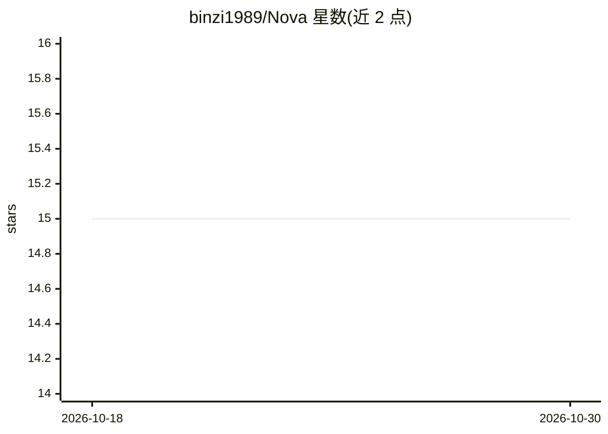

# binzi1989/Nova

⭐ 15 · C# · 推送 2026-08-13 · [GitHub](https://github.com/binzi1989/Nova) · 个人维护 · 中文 README

**本地优先的桌面 AgentOS：把目标转化为文件、测试与证据**

运行在 Windows/macOS PC 上的桌面 AI Agent 系统：绑定真实工作区后，将目标整理为计划与交付标准，调用云模型（DeepSeek、OpenAI、Kimi）或本地 Ollama、MCP、Skills 与多个专业 Agent 执行，产出真实文件并附带测试、审查或来源证据；完成状态以 PROVEN/PARTIAL/BLOCKED 区分。提供交付审查台、权限与预算控制、知识库索引与 CLI 接口。架构为 Electron+React 前端与 .NET 8 内核。当前为 1.1.0-preview，仓库尚未声明开源许可证。

## 筛选速览

| 维度 | 判定 | 备注 |
|---|---|---|
| AI 角色 | `ai-native` | 本体是模型或模型工具 |
| 许可风险 | `none` | — |
| 部署形态 | `None` |  |
| 模型依赖 | local-ok | 支持本地模型 |
| 硬件要求 | — | 无带数字的原话,不猜 |
| 安装摩擦 | `medium` | 含编译或系统依赖之一 |
| 成熟度 | `idea` | |

## 能力要点

- PROVEN/PARTIAL/BLOCKED 三态交付与证据闭环
- 一句话创建专业 Agent 并生成可运行 Agent Pack
- 模型接入含 DeepSeek/OpenAI/Kimi/Ollama 与 OpenAI 兼容接口
- MCP 导入、Skills、知识库、Hook Gateway 等扩展坞能力

## 适用场景

- 把模糊目标交给 Agent 在本地工作区落盘成真实交付物
- 运行中随时纠正方向并在同一上下文续跑
- 按行业定制并校准专业 Agent Pack

## 场景标签

`多智能体` `Agent 框架` · 领域:Agent 开发

## 证据(README 行号)

> L36: NOVA 是一款运行在 PC 上的 **AgentOS**。它不是给聊天窗口加几个工具，而是为 AI 增加一层完整的工作系统：
> L42: 5. 将成果写成真实文件，并给出测试、审查或来源证据；
> L67: |**模型接入**|DeepSeek、OpenAI、Kimi、Ollama、OpenAI-compatible 自定义接口|云模型、本地模型与第三方兼容服务可自由选择|

## 星数曲线

2026-10-18 15 → 2026-10-30 15（+0）

---
*卡片 v1 · prompt 1.4 · 生成 2026-10-30 · 置信度 high · 依据 README sha `8e8b4f47d816` · [字段定义](../../DATASET.md)*
