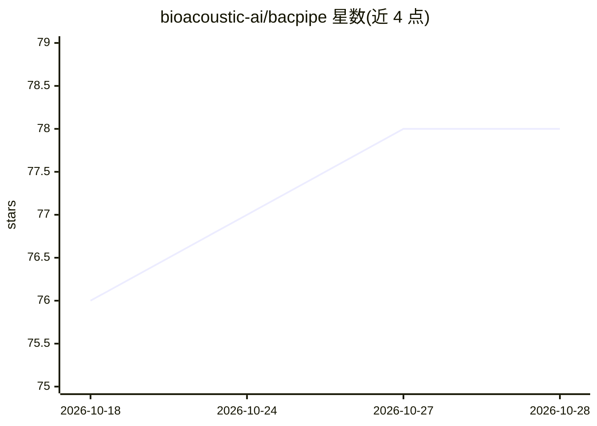

# bioacoustic-ai/bacpipe

⭐ 78 · Jupyter Notebook · Apache-2.0 · 推送 2026-10-22 · [GitHub](https://github.com/bioacoustic-ai/bacpipe) · [官网](https://bacpipe.readthedocs.io) · 组织维护

**生物声学深度学习管线：批量生成音频嵌入并评估**

面向生物声学研究者的 Python 管线：读取音频数据集，调用约 28 个生物声学深度学习模型（BirdNET、BEATs、Perch、BatDetect2 等）批量生成嵌入与分类预测，再用 PCA/UMAP/t-SNE 等降维，并通过 probing 与聚类任务评估结果；附带基于 panel 的交互式 dashboard 可视化。通过 config.yaml 配置，支持 annotations.csv 标注文件，提供 6 个 Jupyter 示例笔记本。支持 Python 3.11/3.12，Windows 上部分 TensorFlow 模型仅限 3.11。

## 筛选速览

| 维度 | 判定 | 备注 |
|---|---|---|
| AI 角色 | `ai-native` | 本体是模型或模型工具 |
| 许可风险 | `permissive` | Apache-2.0 |
| 部署形态 | `desktop` | 安装包/桌面程序 |
| 模型依赖 | — | README 未给出锁定关系 |
| 硬件要求 | — | 无带数字的原话,不猜 |
| 安装摩擦 | `medium` | 含编译或系统依赖之一 |
| 成熟度 | — | 结构信号不足 |

## 能力要点

- 约 28 个生物声学模型的统一推理与嵌入生成
- probing/聚类下游评估与标准化结果目录
- 基于 panel 的 dashboard 交互式嵌入可视化
- 支持 annotations.csv 标注读取与自定义模型接入

## 适用场景

- 对野外录音批量生成多模型嵌入并比较
- 用聚类或 probing 评估模型在自定义数据集上的表现
- 在 dashboard 中按物种/聚类标签探索嵌入分布

## 场景标签

`模型评测` · 领域:评测与运维

## 证据(README 行号)

> L19: **bacpipe** makes using deep learning models for bioacoustics easy!
> L20: Using **bacpipe** you can generate embeddings and classifier predictions and evaluate them using probing, clusterin
> L58: **bacpipe** requires a dataset of audio files, runs them through a series of models, and generates embeddings. Thes

## 星数曲线

2026-10-18 76 → 2026-10-28 78（+2）

---
*卡片 v1 · prompt 1.4 · 生成 2026-10-24 · 置信度 high · 依据 README sha `c2a3e8ae138a` · [字段定义](../../DATASET.md)*
