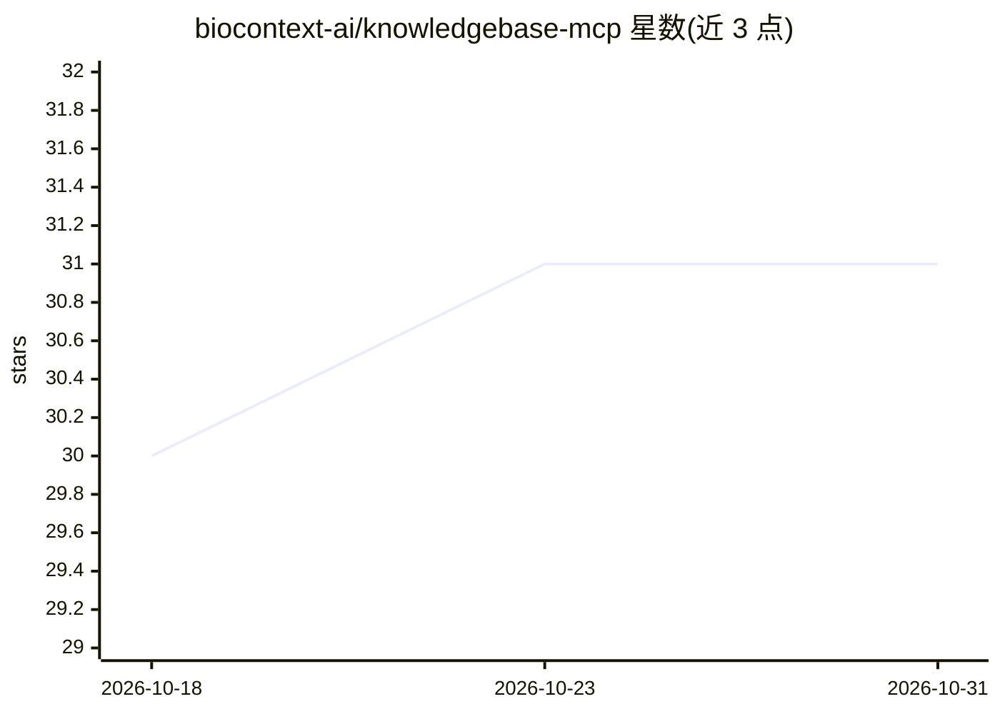

# biocontext-ai/knowledgebase-mcp

⭐ 31 · Python · Apache-2.0 · 推送 2026-10-12 · [GitHub](https://github.com/biocontext-ai/knowledgebase-mcp) · [官网](https://biocontext.ai/registry/biocontext-ai/knowledgebase-mcp) · 组织维护

**生物医学 MCP 服务器：让 agentic AI 统一检索生物医学数据库**

基于 Model Context Protocol 的服务器，作为 AI 系统（Claude Desktop、IDE 编码 agent、自建 agent）与生物医学资源之间的标准化连接层，暴露 Antibody Registry、EuropePMC、InterPro、Reactome、STRING、AlphaFold DB 等外部生物医学 API 的检索与领域任务能力。支持 uvx 本地运行、stdio/streamable HTTP 两种传输及 Docker 部署，另有仅供测试的远程服务器。可通过 OpenAPI 配置文件扩展新的工具服务，属 BioContextAI 项目的一部分。

## 筛选速览

| 维度 | 判定 | 备注 |
|---|---|---|
| AI 角色 | `ai-ecosystem` | LLM/agent 周边工具 |
| 许可风险 | `permissive` | Apache-2.0 |
| 部署形态 | `self-host` | docker 或自建部署 |
| 模型依赖 | — | README 未给出锁定关系 |
| 硬件要求 | — | 无带数字的原话,不猜 |
| 安装摩擦 | `low` | 无编译、无系统依赖或容器化 |
| 成熟度 | — | 结构信号不足 |

## 能力要点

- 通过 MCP 统一接入十余个生物医学数据库与工具 API
- 支持 Claude Desktop、VS Code/Cursor/WindSurf 等 IDE 及自建 agent 接入
- uvx 本地运行（stdio/streamable HTTP）与 Docker 部署
- OpenAPI 配置文件可自动生成新 MCP 工具服务

## 适用场景

- 让 Claude Desktop 或 IDE 编码 agent 检索文献、蛋白互作、通路等生物医学数据
- 自建生物医学 agent 系统时作为数据访问层
- 本地部署避开远程服务器速率限制

## 场景标签

`科研工具` · 领域:学习与行业

## 证据(README 行号)

> L12: A Model Context Protocol (MCP) server for biomedical research that provides a standardized connection layer between
> L16: **BioContextAI Knowledgebase MCP** is an MCP server implementation for common biomedical resources, enabling agenti

## 星数曲线

2026-10-18 30 → 2026-10-31 31（+1）

---
*卡片 v1 · prompt 1.4 · 生成 2026-10-26 · 置信度 high · 依据 README sha `00a78ecf684d` · [字段定义](../../DATASET.md)*
