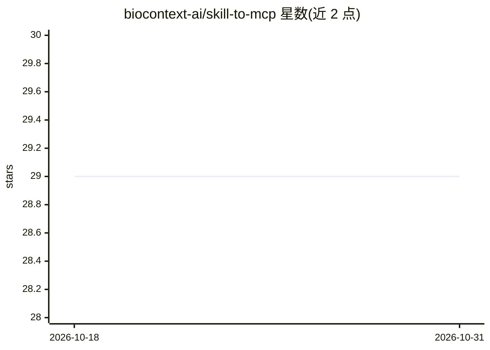

# biocontext-ai/skill-to-mcp

⭐ 29 · Python · Apache-2.0 · 推送 2026-02-27 · [GitHub](https://github.com/biocontext-ai/skill-to-mcp) · [官网](https://biocontext.ai/registry/biocontext-ai/skill-to-mcp) · 组织维护

**将 Claude 格式 Skills 转为 MCP 资源的 MCP 服务器**

BioContextAI Registry 的一部分：把遵循 Claude Skills 格式（含 SKILL.md 与 YAML frontmatter）的技能目录暴露为 MCP server 资源，供 LLM 应用通过 Model Context Protocol 访问。提供三个工具：列出可用技能、读取技能详情、读取技能目录内文件（含路径校验防护）。包本身领域无关，可用于任意技能集合，开发初衷面向生物医学研究社区。支持 uvx 即时运行、pip 安装、MCP 客户端集成及 Docker 部署，需 Python 3.11+。

## 筛选速览

| 维度 | 判定 | 备注 |
|---|---|---|
| AI 角色 | `ai-ecosystem` | LLM/agent 周边工具 |
| 许可风险 | `permissive` | Apache-2.0 |
| 部署形态 | `self-host` | docker 或自建部署 |
| 模型依赖 | — | README 未给出锁定关系 |
| 硬件要求 | — | 无带数字的原话,不猜 |
| 安装摩擦 | `low` | 无编译、无系统依赖或容器化 |
| 成熟度 | — | 结构信号不足 |

## 能力要点

- 递归发现 skills/ 目录下的 SKILL.md 并解析 frontmatter 元数据
- get_available_skills / get_skill_details / get_skill_related_file 三个核心工具
- 路径校验防止访问技能目录之外的文件
- 支持 HTTP transport 生产部署与 Docker 部署

## 适用场景

- 让 MCP 客户端（如 Claude Desktop）读取我的技能合集
- 生物医学研究 agent 通过 MCP 获取领域技能内容
- 同一服务器实例按项目挂载不同技能目录

## 场景标签

`Agent 框架` · 领域:Agent 开发

## 证据(README 行号)

> L9: Convert AI Skills (following Claude Skills format) into MCP server resources, making them accessible through the Mod
> L15: This MCP server exposes Claude Skills as resources that can be accessed by LLM applications through the Model Conte
> L11: > **Part of BioContextAI** - A community-driven initiative connecting agentic AI with biomedical resources through 

## 星数曲线

2026-10-18 29 → 2026-10-31 29（+0）

---
*卡片 v1 · prompt 1.4 · 生成 2026-10-26 · 置信度 high · 依据 README sha `ec506aa618e1` · [字段定义](../../DATASET.md)*
