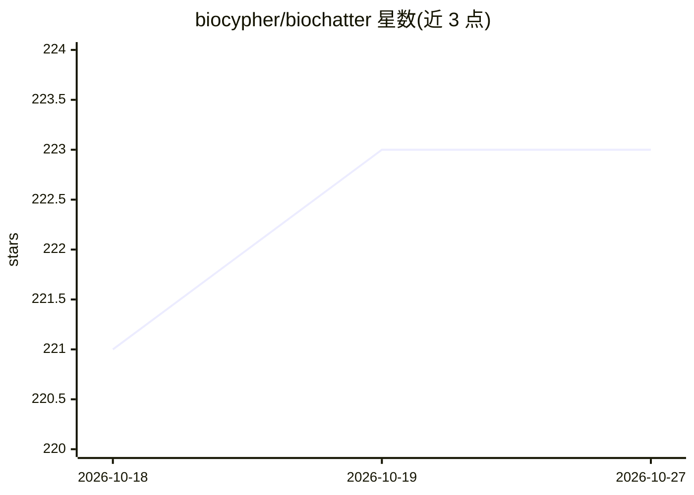

# biocypher/biochatter

⭐ 223 · Jupyter Notebook · Apache-2.0 · 推送 2026-07-31 · [GitHub](https://github.com/biocypher/biochatter) · [官网](http://biochatter.org/) · 组织维护

**连接生物医学应用与对话式 AI 的 Python 后端库**

社区驱动的 Python 库，作为生物医学应用接入生成式 AI 的通用后端：集成多个 LLM 提供商，原生连接 BioCypher 知识图谱，提供测试与评测框架及生物医学应用的持续基准。可选扩展包括 Xorbits Inference 查询开源 LLM、Google TTS 播客语音、Streamlit UI。配套 BioChatter Light（Python 前端）、BioChatter Next（Next.js 前端）与 BioChatter Server（RESTful API）。从 PyPI 安装，面向生物医学领域的开发者。

## 筛选速览

| 维度 | 判定 | 备注 |
|---|---|---|
| AI 角色 | `ai-ecosystem` | LLM/agent 周边工具 |
| 许可风险 | `permissive` | Apache-2.0 |
| 部署形态 | `library` | 以包/库形式分发 |
| 模型依赖 | — | README 未给出锁定关系 |
| 硬件要求 | — | 无带数字的原话,不猜 |
| 安装摩擦 | `low` | 无编译、无系统依赖或容器化 |
| 成熟度 | — | 结构信号不足 |

## 能力要点

- 生物医学 AI 应用的通用后端，集成多个 LLM 提供商
- 原生连接 BioCypher 知识图谱
- 测试与评测框架及持续更新的生物医学应用基准
- xinference/podcast/streamlit 可选扩展

## 适用场景

- 为生物医学应用搭建对话式 AI 后端
- 结合 BioCypher 知识图谱做知识问答
- 复用其评测框架测试生物医学 LLM 应用

## 场景标签

`RAG` `知识图谱` `模型评测` · 领域:评测与运维

## 证据(README 行号)

> L12: 🤖 BioChatter is a community-driven Python library that connects biomedical
> L13: applications to conversational AI, making it easy to leverage generative AI
> L18: - Seamless integration with multiple LLM providers

## 星数曲线

2026-10-18 221 → 2026-10-27 223（+2）

---
*卡片 v1 · prompt 1.4 · 生成 2026-10-22 · 置信度 high · 依据 README sha `6ca34f20012d` · [字段定义](../../DATASET.md)*
