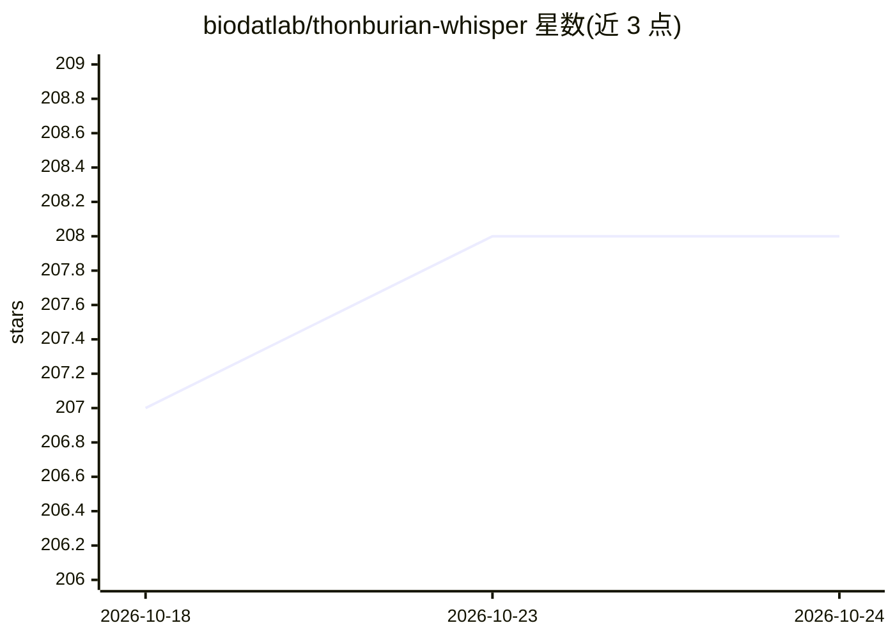

# biodatlab/thonburian-whisper

⭐ 208 · Jupyter Notebook · MIT · 推送 2026-04-02 · [GitHub](https://github.com/biodatlab/thonburian-whisper) · [官网](https://huggingface.co/spaces/biodatlab/whisper-thai-demo) · 组织维护

**面向泰语的 Whisper 微调/蒸馏 ASR 模型集合**

由玛希隆大学 Biomedical and Data Lab 等团队发布的泰语自动语音识别模型：基于 OpenAI Whisper 在 Common Voice 13、Gowajee、泰国老年语音、泰语方言等语料上微调，提供 small/medium/large-v2/v3 标准模型、蒸馏模型（4 层解码器）及带时间戳的 medium 变体。模型与蒸馏版本托管于 Huggingface Hub，通过 transformers pipeline 调用，另含长音频转写方案（VAD+分块+词级对齐）。large-v3 在 Common Voice 13 上 WER 6.59。限制：带时间戳版本准确率低于无时间戳版本。

## 筛选速览

| 维度 | 判定 | 备注 |
|---|---|---|
| AI 角色 | `ai-native` | 本体是模型或模型工具 |
| 许可风险 | `permissive` | MIT |
| 部署形态 | `library` | 以包/库形式分发 |
| 模型依赖 | — | README 未给出锁定关系 |
| 硬件要求 | — | 无带数字的原话,不猜 |
| 安装摩擦 | `medium` | 含编译或系统依赖之一 |
| 成熟度 | — | 结构信号不足 |

## 能力要点

- 微调 Whisper small/medium/large-v2/v3 于泰语语料，large-v3 WER 6.59
- 蒸馏模型仅 4 层解码器，参数量降至 166M–809M
- medium-timestamps 变体支持时间戳生成（WER 15.57）
- 长音频转写：VAD+泰语分词+分块的词级对齐方案

## 适用场景

- 泰语语音转文字（含金融、医疗领域音频）
- 生成带时间戳的泰语字幕或音文对齐
- 资源受限环境下用蒸馏模型做泰语 ASR

## 场景标签

`语音识别` · 领域:感知与多模态

## 证据(README 行号)

> L3: **Thonburian Whisper** is an Automatic Speech Recognition (ASR) model for Thai, fine-tuned using Whisper model
> L4: originally from OpenAI. The model is released as a part of Huggingface's Whisper fine-tuning event (December 2022). 

## 星数曲线

2026-10-18 207 → 2026-10-24 208（+1）

---
*卡片 v1 · prompt 1.4 · 生成 2026-10-22 · 置信度 mid · 依据 README sha `3323378a5875` · [字段定义](../../DATASET.md)*
