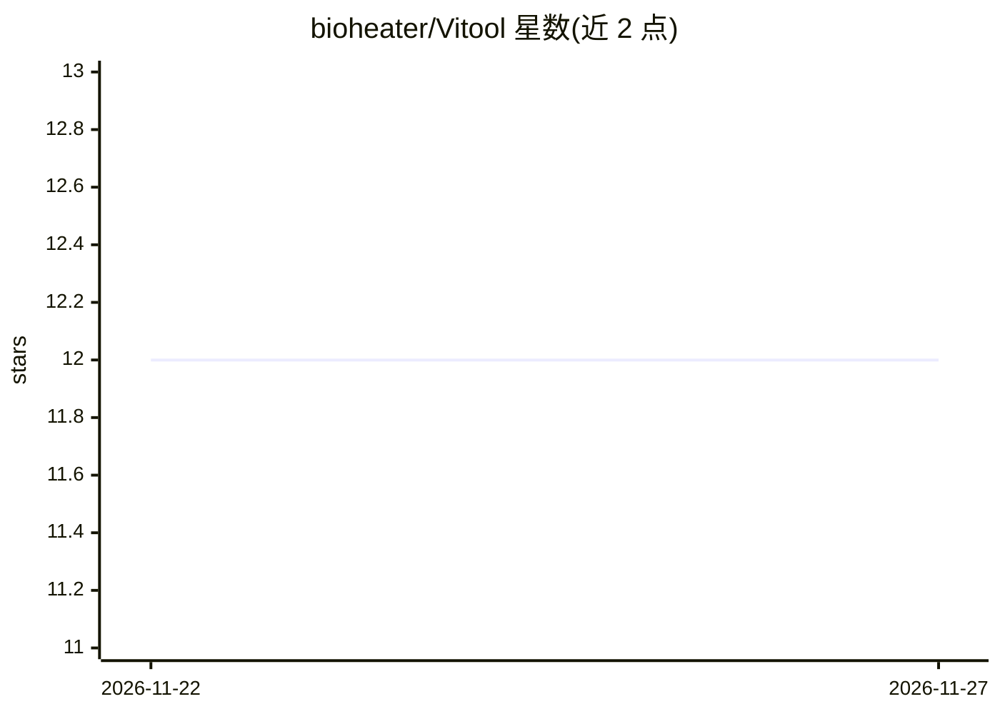

# bioheater/Vitool

⭐ 12 · JavaScript · AGPL-3.0 · 推送 2026-11-24 · [GitHub](https://github.com/bioheater/Vitool) · 个人维护

**Windows 本地视频工具箱：下载、剪辑、打码、转录与总结**

基于 yt-dlp 与 FFmpeg 的 Windows 桌面应用，功能覆盖视频下载（含 SponsorBlock 与多音轨）、无损/精确剪切、格式转换、GIF 制作、绿幕抠像、打码、MKV 音轨管理、去静音与降噪等。AI 部分包括可选插件 AI Mask（SAM 2.1 点击选物体并跟踪模糊）与 Transcribe（Whisper 转录加 pyannote 说话人区分），以及基于 Ollama 或在线 API 的视频摘要与问答。所有处理默认本地完成，安装包未签名，可选插件自带 Python 运行时。

## 筛选速览

| 维度 | 判定 | 备注 |
|---|---|---|
| AI 角色 | `ai-enhanced` | 去掉 AI 部分产品仍成立 |
| 许可风险 | `viral` | AGPL-3.0 |
| 部署形态 | `desktop` | 安装包/桌面程序 |
| 模型依赖 | local-ok | 支持本地模型 |
| 硬件要求 | — | 无带数字的原话,不猜 |
| 安装摩擦 | `medium` | 含编译或系统依赖之一 |
| 成熟度 | — | 结构信号不足 |

## 能力要点

- 下载、剪切、转换、打码、转录、总结集成于单一本地应用
- AI Mask 用 SAM 2.1 点击选物体并跨帧跟踪
- Transcribe 用 Whisper 转录并用 pyannote 区分说话人
- 摘要可经本地 Ollama 运行，或用自带 API key 的在线服务

## 适用场景

- 从 YouTube/TikTok 等站点下载视频并按质量与音轨管理
- 对视频中人物或物体做跟踪打码
- 生成带说话人标注的字幕文件或烧录字幕
- 本地生成视频摘要并基于时间戳提问

## 场景标签

`语音识别` `图像视频处理` · 领域:感知与多模态

## 证据(README 行号)

> L5:  An all-in-one video toolbox for Windows: download, cut, convert, clean up audio, censor, mask, transcribe and summa
> L81: ### AI Mask (optional add-on)
> L98: - Runs locally with Ollama and the model of your choice. Long videos are read in parts

## 星数曲线

2026-11-22 12 → 2026-11-27 12（+0）

---
*卡片 v1 · prompt 1.4 · 生成 2026-11-22 · 置信度 high · 依据 README sha `44f2dc462bd9` · [字段定义](../../DATASET.md)*
