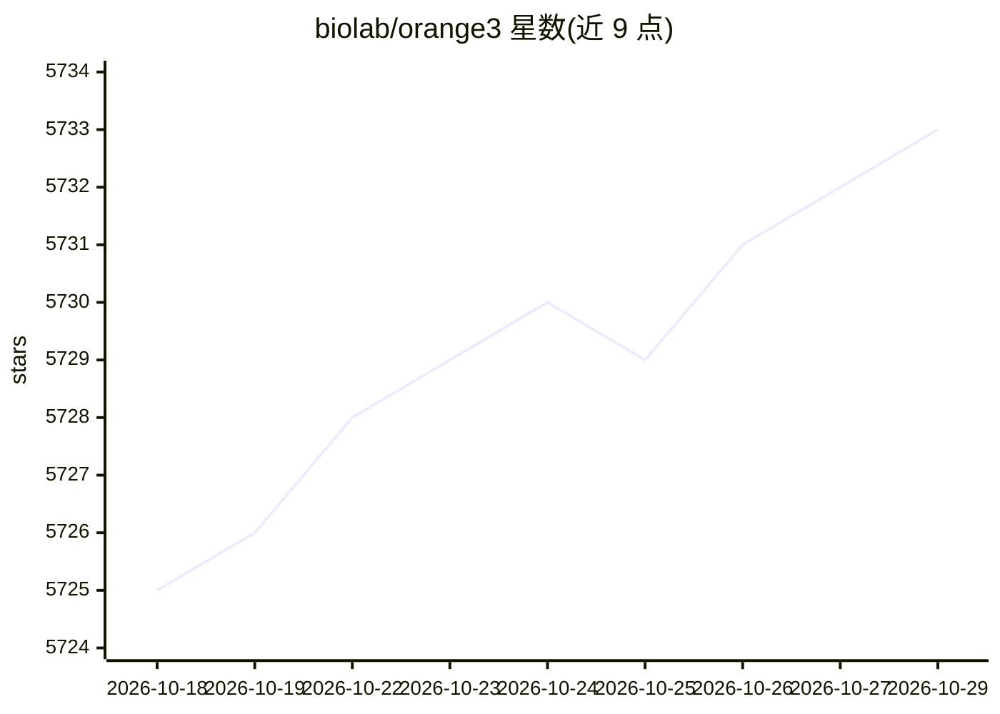

# biolab/orange3

⭐ 5,733 · Python · NOASSERTION · 推送 2026-10-26 · [GitHub](https://github.com/biolab/orange3) · [官网](https://orangedatamining.com) · 组织维护

**面向无编程背景用户的开源数据挖掘与可视化工具箱**

基于工作流（widget 画布）的交互式数据挖掘与可视化工具箱，提供分类、聚类、决策树等机器学习功能，面向新手与专家，无需编程或深入数学知识即可探索数据。核心由 orange-canvas-core（画布）与 orange-widget-base（widget GUI 库）构成，支持任何人编写 add-on 扩展 widget，官方维护文本、生物信息、时间序列、单细胞、图像、地理等十余个第一方 add-on。Windows/macOS 提供安装包，Linux 或开发场景经 conda、pip 或 uv 安装（pip 路径可能需要 C/C++ 编译器）。

## 筛选速览

| 维度 | 判定 | 备注 |
|---|---|---|
| AI 角色 | `ai-native` | 本体是模型或模型工具 |
| 许可风险 | `none` | NOASSERTION |
| 部署形态 | `library` | 以包/库形式分发 |
| 模型依赖 | — | README 未给出锁定关系 |
| 硬件要求 | — | 无带数字的原话,不猜 |
| 安装摩擦 | `low` | 无编译、无系统依赖或容器化 |
| 成熟度 | — | 结构信号不足 |

## 能力要点

- 工作流式可视化数据探索，无需编程基础
- 内置分类、聚类、决策树等数据挖掘 widget
- add-on 扩展机制，含 10 个第一方领域 add-on
- Windows/macOS 独立安装包，另有 conda/pip/uv/winget 安装途径

## 适用场景

- 不写代码就能对自有数据做可视化探索与建模
- 在教学或科研中通过拖拽工作流完成分类、聚类分析
- 按领域需求安装文本、单细胞、地理等 add-on 扩展功能

## 场景标签

`数据分析` · 领域:效率与自动化

## 证据(README 行号)

> L15: [Orange] is a data mining and visualization toolbox for novice and expert alike. To explore data with Orange, one r
> L80: winget install --id  UniversityofLjubljana.Orange

## 星数曲线

2026-10-18 5,725 → 2026-10-29 5,733（+8）

---
*卡片 v1 · prompt 1.4 · 生成 2026-10-20 · 置信度 high · 依据 README sha `af2923c69b18` · [字段定义](../../DATASET.md)*
