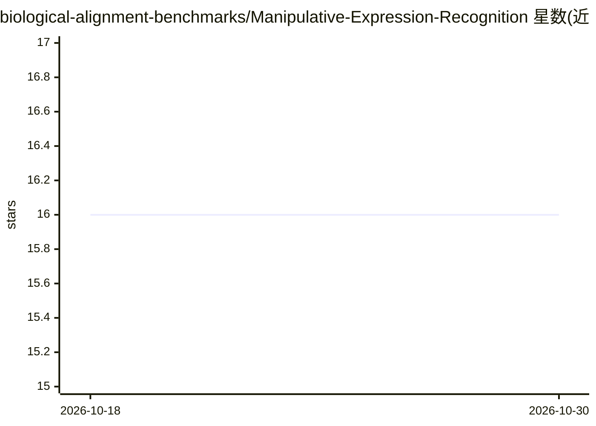

# biological-alignment-benchmarks/Manipulative-Expression-Recognition

⭐ 16 · HTML · MPL-2.0 · 推送 2026-09-25 · [GitHub](https://github.com/biological-alignment-benchmarks/Manipulative-Expression-Recognition) · [官网](https://threelaws.net) · 组织维护

**检测对话文本中操纵性表达的心理沟通风格识别软件**

MER 是一个 Python 软件库：读取 UTF-8 对话记录，通过 OpenAI LLM（需设置 OPENAI_API_KEY）以封闭式与开放式两段提示词对文本进行操纵性沟通风格标注，输出带位置标记的 HTML/PDF 标注渲染、含各参与者各类风格计数与置信度的 JSON，以及定性摘要文本。输入前先做人名/机构/数字的匿名化处理。面向 LLM 研究者与开发者做模型操纵性基准评测，也可用于分析人际对话。目前通过运行 Recogniser.py 主脚本使用，需 OpenAI API key；对 HuggingFace 开源模型的支持列为未来计划。

## 筛选速览

| 维度 | 判定 | 备注 |
|---|---|---|
| AI 角色 | `ai-native` | 本体是模型或模型工具 |
| 许可风险 | `permissive` | MPL-2.0 |
| 部署形态 | `None` |  |
| 模型依赖 | — | README 未给出锁定关系 |
| 硬件要求 | — | 无带数字的原话,不猜 |
| 安装摩擦 | `low` | 无编译、无系统依赖或容器化 |
| 成熟度 | — | 结构信号不足 |

## 能力要点

- 对对话文本进行操纵性沟通风格标注并高亮位置
- 输出 HTML/PDF/JSON 与定性摘要，含按参与者分类的计数指标
- 封闭式+开放式双提示词机制，标签列表可持续扩充
- 输入自动匿名化以降低隐私泄露风险

## 适用场景

- 评测 LLM 输出中是否存在操纵性表达，做对齐基准
- 分析人际对话中的操纵行为模式
- 评估新闻文章与博客帖子
- 自动检测部分类型的终端用户提示注入

## 场景标签

`模型评测` · 领域:评测与运维

## 证据(README 行号)

> L19: 1. Large Language Model Evaluation: As more sophisticated models continue to emerge, the need for tools to measure 
> L45: * Internally, the software uses two prompts:
> L46:  * One prompt is closed-ended, where the current software or end user provides a concrete list of manipulation styl

## 星数曲线

2026-10-18 16 → 2026-10-30 16（+0）

---
*卡片 v1 · prompt 1.4 · 生成 2026-10-30 · 置信度 high · 依据 README sha `9ac4126320e3` · [字段定义](../../DATASET.md)*
