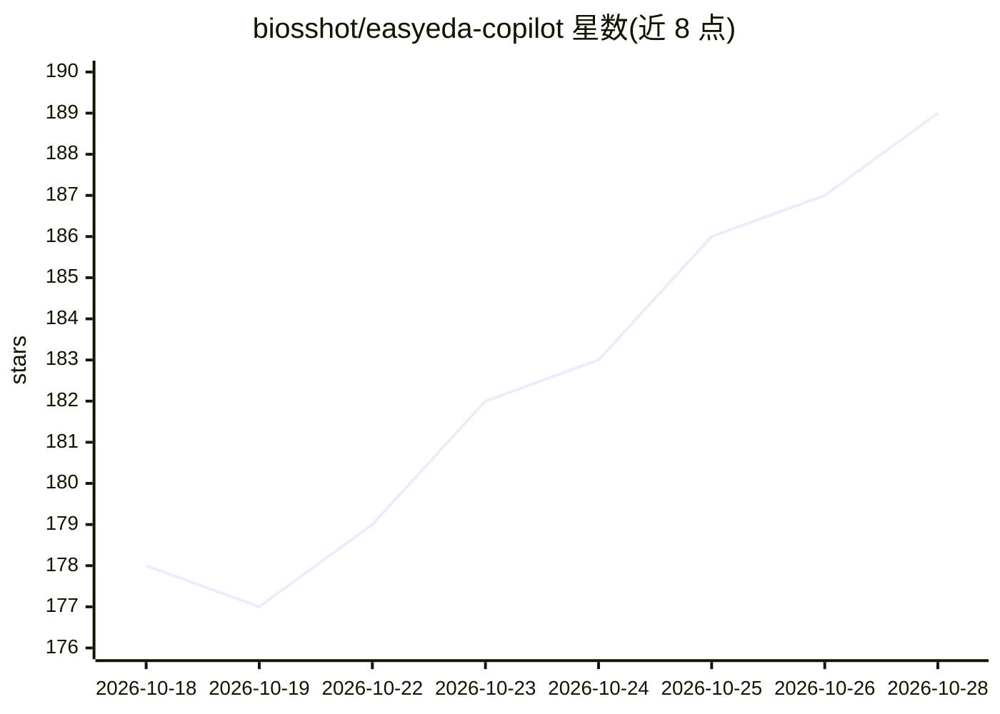

# biosshot/easyeda-copilot

⭐ 189 · TypeScript · MIT · 推送 2026-10-22 · [GitHub](https://github.com/biosshot/easyeda-copilot) · 个人维护 · 中文 README

**把 MCP AI 代理接入 EasyEDA Pro 原理图/PCB 设计的工具**

EasyEDA Copilot 由 EasyEDA Pro 扩展（.eext 包）与 MCP 服务器组成，将 Codex、Claude Code 等 MCP 客户端连接到本地打开的原理图与 PCB 文档。能力覆盖：原理图生成与重组、按 MPN/UUID 解析元件、约束驱动的 PCB 布局与布线（DSL 描述）、层感知预览与检查、原生 DRC 读取与运行。修改前保存全文档检查点，失败自动回滚，结果保持为可编辑的原生 EasyEDA 对象。要求 EasyEDA Pro Desktop 与 Node.js >=20.19，兼容版本主要在 Desktop V2.2.45–V3.2.149 验证。

## 筛选速览

| 维度 | 判定 | 备注 |
|---|---|---|
| AI 角色 | `ai-ecosystem` | LLM/agent 周边工具 |
| 许可风险 | `permissive` | MIT |
| 部署形态 | `library` | 以包/库形式分发 |
| 模型依赖 | — | README 未给出锁定关系 |
| 硬件要求 | — | 无带数字的原话,不猜 |
| 安装摩擦 | `low` | 无编译、无系统依赖或容器化 |
| 成熟度 | — | 结构信号不足 |

## 能力要点

- 原理图生成/重组、多页位号标注（preserve/resequence 两种模式）
- 基于布局/布线 DSL 的约束驱动 PCB 布局、布线、铺铜与过孔缝合
- 全文档检查点与事务化修改：失败自动回滚，可手动列出/保存/恢复
- 读取并运行原生 EasyEDA DRC，检查违规并选择保留/修复/还原

## 适用场景

- 用自然语言让 AI 代理在 EasyEDA Pro 里生成和组装电路原理图
- 对已有原理图做功能块重组与美化而不破坏电气连接
- 在检查点保护下进行 PCB 布局、布线与 DRC 修复

## 场景标签

`Agent 框架` · 领域:Agent 开发

## 证据(README 行号)

> L5: MCP-based engineering automation for native EasyEDA Pro and JLCEDA documents.
> L7: EasyEDA Copilot connects MCP-capable AI agents to real schematic and PCB data. It supports schematic generation and 
> L95: - an MCP-capable client such as Codex or Claude Code.

## 星数曲线

2026-10-18 178 → 2026-10-28 189（+11）

---
*卡片 v1 · prompt 1.4 · 生成 2026-10-22 · 置信度 high · 依据 README sha `fbc67ac03edb` · [字段定义](../../DATASET.md)*
