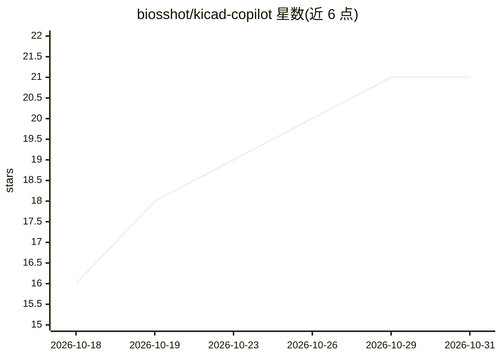

# biosshot/kicad-copilot

⭐ 21 · TypeScript · MIT · 推送 2026-08-23 · [GitHub](https://github.com/biosshot/kicad-copilot) · 个人维护

**面向 AI agent 的 KiCad MCP 服务器：自然语言生成原理图与 PCB**

作为 MCP 服务器为 AI agent 提供文件级的 KiCad 操作接口：直接读写 .kicad_pro/.kicad_sch/.kicad_pcb 文件，无需 KiCad 内插件。支持原理图元件增删改与连接、按 MPN/UUID 检索真实元件、层级工程管理、可恢复检查点、PCB 布局 DSL（含 PNG/SVG 预览）、本地布线（eda-copilot-router）与敷铜；通过发现 kicad-cli 执行 ERC/DRC 与导出，并集成 kicad-happy 做设计分析。要求 Node.js 20+、KiCad 9 或 10、Python 3。以 npx 方式接入 Codex、Claude Code 等客户端。

## 筛选速览

| 维度 | 判定 | 备注 |
|---|---|---|
| AI 角色 | `ai-ecosystem` | LLM/agent 周边工具 |
| 许可风险 | `permissive` | MIT |
| 部署形态 | `library` | 以包/库形式分发 |
| 模型依赖 | — | README 未给出锁定关系 |
| 硬件要求 | — | 无带数字的原话,不猜 |
| 安装摩擦 | `low` | 无编译、无系统依赖或容器化 |
| 成熟度 | — | 结构信号不足 |

## 能力要点

- 自然语言驱动的原理图生成/修改与真实元件检索（MPN/UUID）
- JavaScript 布局 DSL + 预览审批流程 + 本地布线与敷铜
- 可恢复的文件级检查点与原子化应用
- kicad-cli 集成（ERC/DRC/导出）与 kicad-happy 离线设计分析

## 适用场景

- 让编程类 agent 按自然语言指令搭建和修改 KiCad 工程
- 从原理图到 PCB 布局、布线的 agent 化工作流
- 对现有原理图/PCB 做设计检查与报告

## 场景标签

 · 领域:EDA/硬件设计工具

## 证据(README 行号)

> L3: AI-powered MCP server for KiCad. Create and modify schematics from natural language, search real components, work wi
> L24: KiCad Copilot gives AI agents a high-level, file-oriented interface to KiCad:
> L100: codex mcp add kicad-copilot -- npx -y kicad-copilot-mcp

## 星数曲线

2026-10-18 16 → 2026-10-31 21（+5）

---
*卡片 v1 · prompt 1.4 · 生成 2026-10-28 · 置信度 high · 依据 README sha `1ee030a47f88` · [字段定义](../../DATASET.md)*
