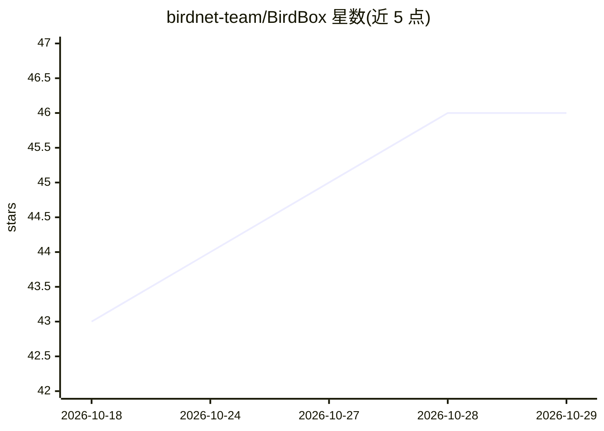

# birdnet-team/BirdBox

⭐ 46 · Python · MIT · 推送 2026-10-28 · [GitHub](https://github.com/birdnet-team/BirdBox) · [官网](https://birdnet-team.github.io/BirdBox/) · 组织维护

**基于 YOLO 频谱图目标检测的鸟类鸣声检测与评估系统**

BirdBox 使用深度学习检测音频录音中的鸟类鸣声：将音频转为频谱图，用 YOLO 目标检测模型在时间与频率维度上识别并定位鸟类发声，覆盖 282 个物种，并提供检测评估功能。以 Python 3.12 项目形式提供，文档包含安装说明、交互式 Streamlit 演示、模型指标与 CLI/API 参考。项目声明仍在积极开发中，性能可能有差异。代码采用 MIT 许可，整体项目为 AGPL-3.0。

## 筛选速览

| 维度 | 判定 | 备注 |
|---|---|---|
| AI 角色 | `ai-native` | 本体是模型或模型工具 |
| 许可风险 | `permissive` | MIT |
| 部署形态 | `None` |  |
| 模型依赖 | — | README 未给出锁定关系 |
| 硬件要求 | — | 无带数字的原话,不猜 |
| 安装摩擦 | `low` | 无编译、无系统依赖或容器化 |
| 成熟度 | `idea` | |

## 能力要点

- YOLO 目标检测作用于频谱图，识别鸟类鸣声的时间-频率定位
- 支持 282 个物种
- 提供 Streamlit 交互式演示与 CLI/API 参考
- 内置检测评估（模型指标列表）

## 适用场景

- 对野外录音做鸟类鸣声的自动检测与定位
- 比较不同检测模型的声学分析指标
- 声学生物多样性研究中进行批量音频分析

## 场景标签

`目标检测` · 领域:感知与多模态

## 证据(README 行号)

> L10: BirdBox is a comprehensive system for detecting and evaluating bird calls in audio recordings using deep learning. 
> L12: ⚠️ **Note**: This project is still under active development. Performance may vary.

## 星数曲线

2026-10-18 43 → 2026-10-29 46（+3）

---
*卡片 v1 · prompt 1.4 · 生成 2026-10-25 · 置信度 high · 依据 README sha `2be8b8da3d44` · [字段定义](../../DATASET.md)*
