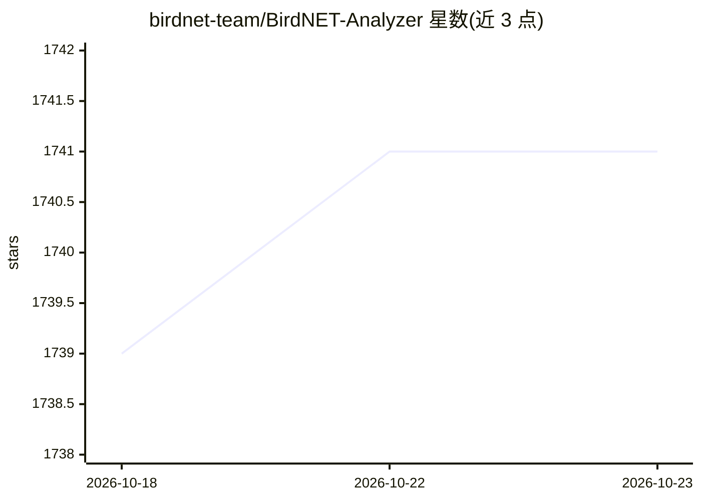

# birdnet-team/BirdNET-Analyzer

⭐ 1,741 · Python · MIT · 推送 2026-10-22 · [GitHub](https://github.com/birdnet-team/BirdNET-Analyzer) · [官网](https://birdnet-team.github.io/BirdNET-Analyzer/) · 组织维护

**面向科研的鸟类鸣声 AI 识别分析工具**

BirdNET 的脚本集合，用于处理大批量音频或单个音频文件，通过深度学习模型识别鸟类物种，供无计算机背景的科学工作者进行声学分析。以 Python 包形式从 PyPI 安装，提供 birdnet-analyze、birdnet-segments、birdnet-species、birdnet-train、birdnet-evaluate 等命令行工具；可选 extras 增加 embedding 提取与相似搜索、超参数自动调优和图形界面。另提供 Windows/macOS 独立安装器、Docker 镜像与模型下载（Zenodo）。由康奈尔鸟类学实验室保护生物声学中心与开姆尼茨工业大学合作开发，源码 MIT 许可。

## 筛选速览

| 维度 | 判定 | 备注 |
|---|---|---|
| AI 角色 | `ai-native` | 本体是模型或模型工具 |
| 许可风险 | `permissive` | MIT |
| 部署形态 | `desktop` | 安装包/桌面程序 |
| 模型依赖 | — | README 未给出锁定关系 |
| 硬件要求 | — | 无带数字的原话,不猜 |
| 安装摩擦 | `low` | 无编译、无系统依赖或容器化 |
| 成熟度 | — | 结构信号不足 |

## 能力要点

- 深度学习模型识别鸟类物种，支持大批量音频处理
- 提供分析、切分、物种列表、训练、评估等 CLI 工具
- 可选 extras：embedding 提取与相似搜索、训练超参调优、GUI
- 提供 Windows/macOS 独立安装器与 Docker 镜像

## 适用场景

- 我对野外录音做批量鸟类物种识别
- 我用自有标注数据训练自定义分类器
- 我通过 embedding 相似搜索组织音频数据集

## 场景标签

`科研工具` `语义搜索` · 领域:知识与检索

## 证据(README 行号)

> L21: This repo contains BirdNET scripts for processing large amounts of audio data or single audio files.
> L29:   title={BirdNET: A deep learning solution for avian diversity monitoring},

## 星数曲线

2026-10-18 1,739 → 2026-10-23 1,741（+2）

---
*卡片 v1 · prompt 1.4 · 生成 2026-10-21 · 置信度 high · 依据 README sha `0846156eafc5` · [字段定义](../../DATASET.md)*
