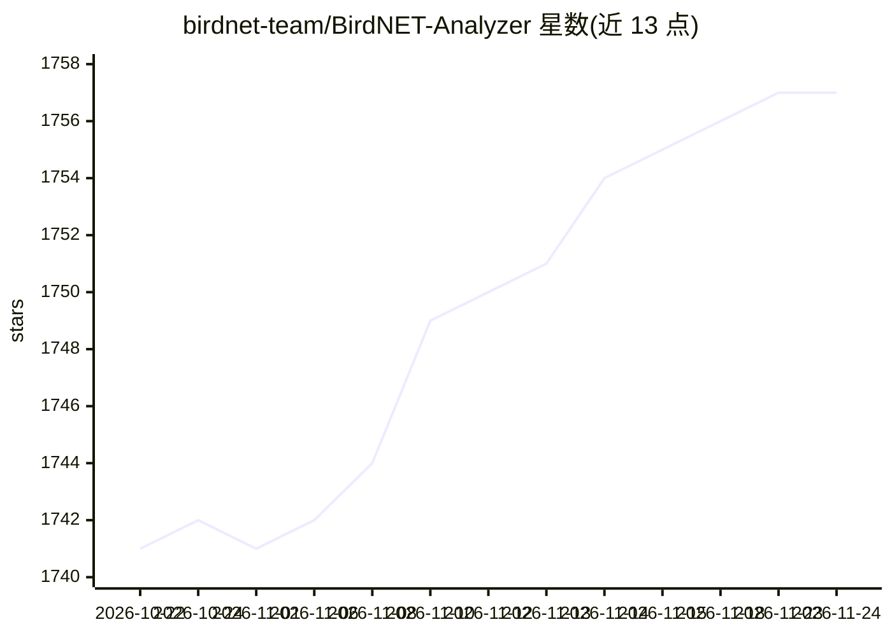

# birdnet-team/BirdNET-Analyzer

⭐ 1,757 · Python · MIT · 推送 2026-11-22 · [GitHub](https://github.com/birdnet-team/BirdNET-Analyzer) · [官网](https://birdnet-team.github.io/BirdNET-Analyzer/) · 组织维护

**面向科研人员的鸟类声学分析深度学习工具**

Cornell鸟类学实验室开发的BirdNET模型实现，提供处理大量音频数据或单个音频文件的脚本与命令行工具（birdnet-analyze、birdnet-segments、birdnet-species、birdnet-train、birdnet-evaluate），用于鸟类声音识别与声学多样性监测。支持训练自定义分类器、嵌入提取与相似性搜索，可通过 PyPI extras 启用 GUI。面向无计算机科学背景的科研人员设计，提供 Windows/macOS 安装包及 Linux AppImage/.deb 包，模型托管于 Zenodo，源码采用 MIT 许可。

## 筛选速览

| 维度 | 判定 | 备注 |
|---|---|---|
| AI 角色 | `ai-native` | 本体是模型或模型工具 |
| 许可风险 | `permissive` | MIT |
| 部署形态 | `desktop` | 安装包/桌面程序 |
| 模型依赖 | — | README 未给出锁定关系 |
| 硬件要求 | — | 无带数字的原话,不猜 |
| 安装摩擦 | `low` | 无编译、无系统依赖或容器化 |
| 成熟度 | — | 结构信号不足 |

## 能力要点

- 处理大规模音频数据或单文件的命令行工具集
- 支持训练自定义分类器并含超参数自动调优 extras
- 嵌入提取与相似性搜索（birdnet-embeddings/birdnet-search）
- 提供 GUI、Docker 镜像及各平台安装包

## 适用场景

- 批量分析长时间录音中的鸟类物种
- 为本地物种训练自定义声音分类器
- 通过嵌入搜索进行声音相似性检索

## 场景标签

`科研工具` `微调` `语义搜索` · 领域:知识与检索

## 证据(README 行号)

> L21: This repo contains BirdNET scripts for processing large amounts of audio data or single audio files.
> L22: This is the most advanced version of BirdNET for acoustic analyses and we will keep this repository up-to-date with
> L75: Developed by the K. Lisa Yang Center for Conservation Bioacoustics at the Cornell Lab of Ornithology in collaborati

## 星数曲线

2026-10-22 1,741 → 2026-11-24 1,757（+16）

---
*卡片 v1 · prompt 1.4 · 生成 2026-11-23 · 置信度 high · 依据 README sha `d716a4cddb1a` · [字段定义](../../DATASET.md)*
