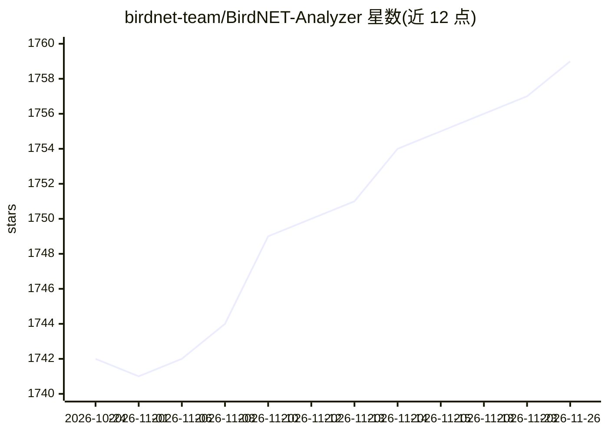

# birdnet-team/BirdNET-Analyzer

⭐ 1,759 · Python · MIT · 推送 2026-11-25 · [GitHub](https://github.com/birdnet-team/BirdNET-Analyzer) · [官网](https://birdnet-team.github.io/BirdNET-Analyzer/) · 组织维护

**面向科研人员的鸟类声学识别分析工具**

提供处理大量音频数据或单个音频文件的脚本与命令行工具（birdnet-analyze/segments/species/train/evaluate），面向无计算机背景的科研人员运行声学分析。通过 PyPI 安装，可选 extras 提供嵌入提取与相似性搜索、自定义分类器训练与超参自动调优、图形界面。模型托管于 Zenodo，支持 Windows/macOS/Linux 安装包及 Docker 镜像，要求 Python 3.11–3.13。

## 筛选速览

| 维度 | 判定 | 备注 |
|---|---|---|
| AI 角色 | `ai-native` | 本体是模型或模型工具 |
| 许可风险 | `permissive` | MIT |
| 部署形态 | `desktop` | 安装包/桌面程序 |
| 模型依赖 | — | README 未给出锁定关系 |
| 硬件要求 | — | 无带数字的原话,不猜 |
| 安装摩擦 | `low` | 无编译、无系统依赖或容器化 |
| 成熟度 | — | 结构信号不足 |

## 能力要点

- 5 个命令行工具覆盖分析、片段、物种、训练与评估
- 可选 extras：嵌入提取与相似性搜索、分类器训练自动调优、GUI
- 提供 Windows/macOS/Linux 安装包及 Docker 镜像
- 模型文件在 Zenodo 公开（BirdNET 3.0 与 2.4）

## 适用场景

- 批量分析野外录音中的鸟类物种
- 训练自定义分类器识别本地物种
- 提取音频嵌入并做相似性搜索

## 场景标签

`科研工具` `微调` · 领域:学习与行业

## 证据(README 行号)

> L21: This repo contains BirdNET scripts for processing large amounts of audio data or single audio files.
> L22: This is the most advanced version of BirdNET for acoustic analyses and we will keep this repository up-to-date with
> L57: This provides the command line tools `birdnet-analyze`, `birdnet-segments`, `birdnet-species`, `birdnet-train` and 

## 星数曲线

2026-10-24 1,742 → 2026-11-26 1,759（+17）

---
*卡片 v1 · prompt 1.4 · 生成 2026-11-26 · 置信度 high · 依据 README sha `8bac174027b8` · [字段定义](../../DATASET.md)*
