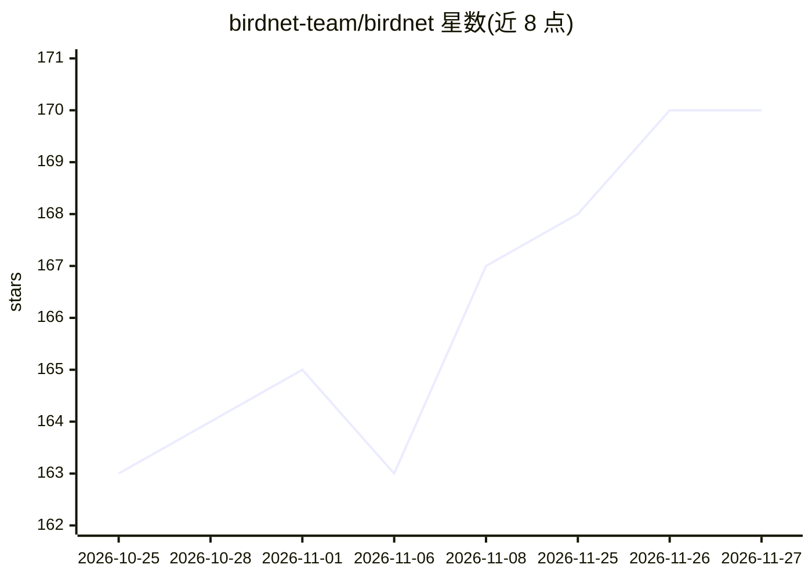

# birdnet-team/birdnet

⭐ 170 · Python · MIT · 推送 2026-11-25 · [GitHub](https://github.com/birdnet-team/birdnet) · [官网](https://birdnet-team.github.io/birdnet/) · 组织维护

**生态声学研究者用 Python 库识别鸟声物种并预测物种分布**

面向生物声学项目的 Python 库：从音频录音中提取分类得分与嵌入向量（V2.4 6,522 类 / V3.0 11,725 类），并按地点与时间预测物种出现概率（V3.0 达 14,082 种）。支持加载 BirdNET-Analyzer 训练的自定义分类器与 Perch V2 模型，后端覆盖 ONNX Runtime、LiteRT、TensorFlow、PyTorch，可 CPU/GPU 运行并支持多 GPU 与多进程批处理。功能不包含 BirdNET-Analyzer 的全部特性；项目处于活跃开发中，接口可能变动。

## 筛选速览

| 维度 | 判定 | 备注 |
|---|---|---|
| AI 角色 | `ai-native` | 本体是模型或模型工具 |
| 许可风险 | `permissive` | MIT |
| 部署形态 | `library` | 以包/库形式分发 |
| 模型依赖 | — | README 未给出锁定关系 |
| 硬件要求 | — | 无带数字的原话,不猜 |
| 安装摩擦 | `medium` | 含编译或系统依赖之一 |
| 成熟度 | `idea` | |

## 能力要点

- 音频物种识别与地理物种预测，V2.4/V3.0 官方模型自动下载，支持完全离线使用
- 四种运行时后端（ONNX Runtime/LiteRT/TensorFlow/PyTorch），支持 CPU/GPU 与多 GPU
- 多进程批处理与低内存占用，适配边缘设备与高性能集群
- 多音频格式输入（WAV/FLAC/OGG/MP3 等），结果可导出 CSV/Arrow/Parquet/Numpy 等

## 适用场景

- 批量分析野外录音中的鸟类物种
- 按地点和季节预测可能出现的物种清单
- 加载 BirdNET-Analyzer 自训练的分类器做推理

## 场景标签

 · 领域:生态/生物声学

## 证据(README 行号)

> L10: A Python library for identifying bird species by their sounds.
> L21: * 🐦 Extract **classification scores and embeddings** from audio recordings — 6,522 classes (V2.4) or 11,725 classes
> L22: * 📍 Predict **species presence** for a given location and time — 6,522 classes (V2.4) or 14,082 species (V3.0)

## 星数曲线

2026-10-25 163 → 2026-11-27 170（+7）

---
*卡片 v1 · prompt 1.4 · 生成 2026-11-26 · 置信度 high · 依据 README sha `713d503921f1` · [字段定义](../../DATASET.md)*
