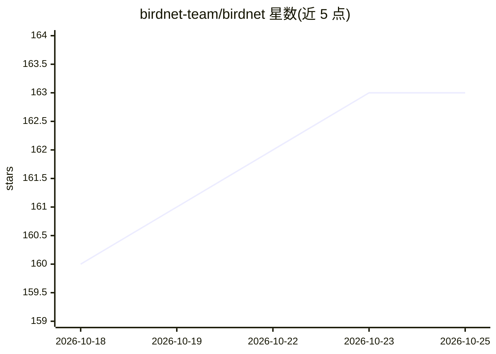

# birdnet-team/birdnet

⭐ 163 · Python · MIT · 推送 2026-10-25 · [GitHub](https://github.com/birdnet-team/birdnet) · [官网](https://birdnet-team.github.io/birdnet/) · 组织维护

**通过鸟鸣声音识别鸟类物种的 Python 库，面向生态声学分析**

提供从音频录音中提取分类得分与嵌入向量、预测给定位置和时间物种存在的工作流，覆盖 6,522 种（V2.4）或 11,000+ 种（V3.0 预览）。基础包内置 ONNX Runtime 与 LiteRT，另提供 TensorFlow、PyTorch 后端扩展，支持 CPU/GPU 执行、多进程批量分析、多种音频与输出格式，并自动下载官方模型。限制：部分功能仅在 BirdNET-Analyzer 中提供；项目处于活跃开发期；libsndfile 需系统安装。另有 R 包版本。

## 筛选速览

| 维度 | 判定 | 备注 |
|---|---|---|
| AI 角色 | `ai-native` | 本体是模型或模型工具 |
| 许可风险 | `permissive` | MIT |
| 部署形态 | `library` | 以包/库形式分发 |
| 模型依赖 | — | README 未给出锁定关系 |
| 硬件要求 | — | 无带数字的原话,不猜 |
| 安装摩擦 | `medium` | 含编译或系统依赖之一 |
| 成熟度 | `idea` | |

## 能力要点

- 从音频提取分类得分与嵌入，覆盖 6,522（V2.4）至 12,000+ 物种（V3.0）
- CPU/GPU 执行（含多 GPU）与多进程批量分析
- 支持 WAV/FLAC/OGG/MP3 等多种音频格式，导出 CSV/Parquet/Arrow 等
- 官方模型自动下载，也可用本地自定义模型完全离线运行

## 适用场景

- 对生态声学录音做大规模鸟类物种识别
- 按地点与时间预测可能出现的鸟类物种
- 在边缘设备或高性能集群上批量处理声景数据

## 场景标签

 · 领域:生态学/生物声学

## 证据(README 行号)

> L10: A Python library for identifying bird species by their sounds.
> L21: * 🐦 Extract **classification scores and embeddings** from audio recordings — 6,522 species (V2.4) or 11,000+ (V3.0 

## 星数曲线

2026-10-18 160 → 2026-10-25 163（+3）

---
*卡片 v1 · prompt 1.4 · 生成 2026-10-22 · 置信度 high · 依据 README sha `da2c2460c7d2` · [字段定义](../../DATASET.md)*
