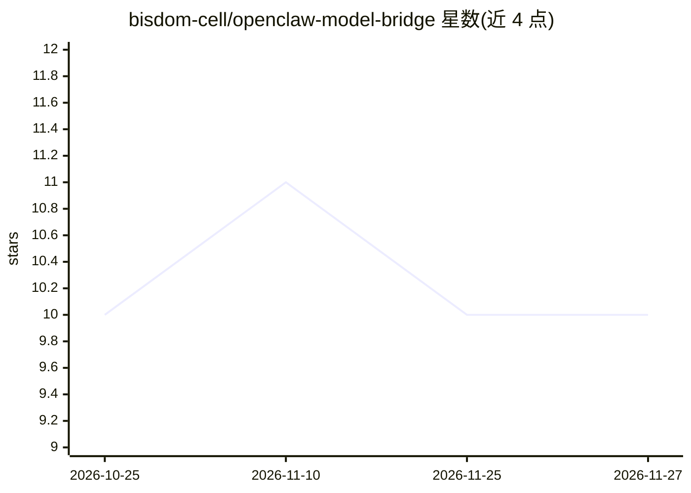

# bisdom-cell/openclaw-model-bridge

⭐ 10 · Python · MIT · 推送 2026-11-20 · [GitHub](https://github.com/bisdom-cell/openclaw-model-bridge) · 个人维护 · 中文 README

**把多家 LLM 一键接入 OpenClaw 的运行时控制面**

面向 OpenClaw 的 Agent 运行时控制面：Layer 1 为纯标准库的 Provider 抽象、工具治理代理、SLO/回退/熔断机制；Layer 2 是发布到 PyPI 的声明式工具本体与治理引擎（不变量/元规则，YAML 配置）；Layer 3 为作者基于该框架构建的 WhatsApp/Discord 个人助理实例，作为前两层的在产验证案例。支持 12-13 家模型供应商接入、能力感知路由与 fail-plausible 静默失败观测研究（附 arXiv 论文）。

## 筛选速览

| 维度 | 判定 | 备注 |
|---|---|---|
| AI 角色 | `ai-ecosystem` | LLM/agent 周边工具 |
| 许可风险 | `permissive` | MIT |
| 部署形态 | `library` | 以包/库形式分发 |
| 模型依赖 | locked-api |  |
| 硬件要求 | — | 无带数字的原话,不猜 |
| 安装摩擦 | `low` | 无编译、无系统依赖或容器化 |
| 成熟度 | — | 结构信号不足 |

## 能力要点

- Layer 1 核心运行时零第三方依赖，仅用 Python 标准库
- 治理引擎以 openclaw-ontology-engine 名称发布到 PyPI，自带 YAML 配置
- Provider 插件框架支持 DeepSeek 量化/满血、豆包、GLM、Kimi 等多家接入
- fail-plausible 静默失败 LLM-Observer 与 sabotage 自验证机制（附 2 篇 arXiv 论文）

## 适用场景

- 把 Qwen/OpenAI/Gemini/Claude 等模型一键接入 OpenClaw 运行
- 为 LLM Agent 请求管线加工具治理与 SLO 熔断回退
- 参考其个人助理实例搭建 WhatsApp/Discord 自动化助手
- 复用其 fail-plausible 基准做静默失败检测实验

## 场景标签

`模型网关` `Agent 框架` · 领域:Agent 开发

## 证据(README 行号)

> L3: > **Agent Runtime Control Plane** — Connect any LLM to OpenClaw with one command. Zero dependencies, **12 providers*
> L25: |**1 · Core Runtime**|Provider abstraction + tool-governance proxy + SLO / fallback / circuit breaker|`adapter.py` 
> L26: |**2 · Governance-Ontology**|Declarative tool ontology + governance engine (invariants / meta-rules — counts in bad

## 星数曲线

2026-10-25 10 → 2026-11-27 10（+0）

---
*卡片 v1 · prompt 1.4 · 生成 2026-11-18 · 置信度 high · 依据 README sha `5a7154b01e27` · [字段定义](../../DATASET.md)*
