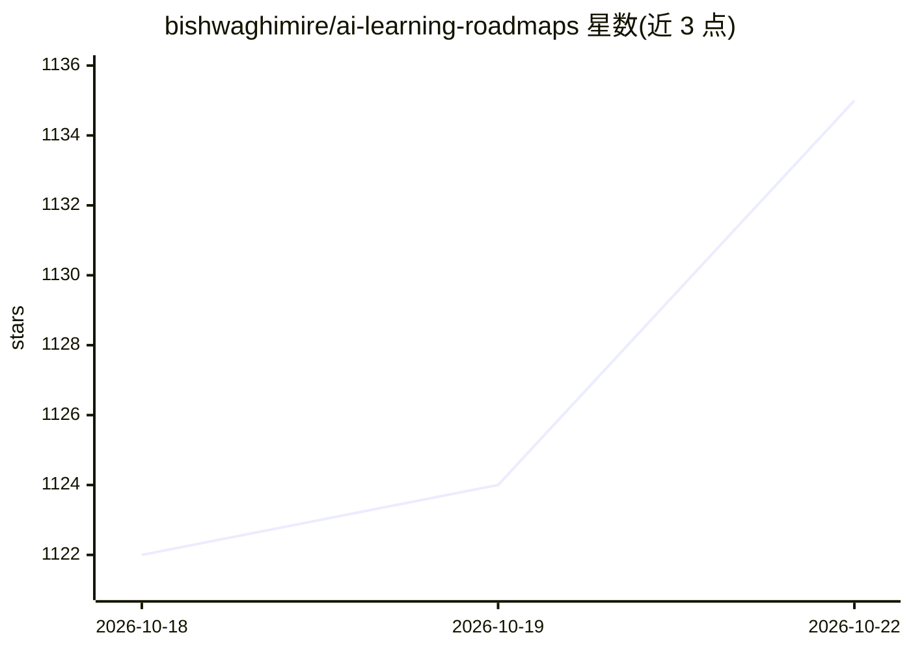

# bishwaghimire/ai-learning-roadmaps

⭐ 1,135 · MIT · 推送 2026-06-15 · [GitHub](https://github.com/bishwaghimire/ai-learning-roadmaps) · 个人维护

**AI/ML/DL 学习资源与路线图策展中心，面向学生与从业者**

面向计算机专业学生、AI 爱好者与从业者的学习资源聚合仓库：按基础（AI/数据科学/ML/DL）到专项（CV/NLP/LLM/生成式 AI/RAG/MLOps/科研/AI 安全）组织多条独立学习路线图，另收录数学基础、编程与框架、工具清单和研究论文的策展链接。资源类型覆盖书籍、课程、YouTube 播放列表与 arXiv 论文，并提供按职业目标（工程师/数据科学家/研究员等）排列的学习顺序建议表。仓库为纯文档形式，无代码或安装步骤。

## 筛选速览

| 维度 | 判定 | 备注 |
|---|---|---|
| AI 角色 | `ai-knowledge` | 知识聚合/清单类 |
| 许可风险 | `permissive` | MIT |
| 部署形态 | `None` |  |
| 模型依赖 | — | README 未给出锁定关系 |
| 硬件要求 | — | 无带数字的原话,不猜 |
| 安装摩擦 | `low` | 无编译、无系统依赖或容器化 |
| 成熟度 | — | 结构信号不足 |

## 能力要点

- 覆盖基础到研究/AI 安全的 10+ 条独立学习路线图
- 按职业目标给出学习顺序建议表（10 种角色）
- 数学基础资源按科目、难度、类型（书/视频/课程）组织
- 策展工具清单（框架、向量库、MLOps、云平台）与经典论文链接

## 适用场景

- 按路线图从零开始系统学习 AI/ML/DL
- 根据目标岗位选择对应的学习顺序
- 查找数学基础、框架工具与经典论文的学习资料

## 场景标签

`教程课程` `精选清单` · 领域:学习与行业

## 证据(README 行号)

> L3:  A structured, end-to-end roadmap to master AI — from fundamentals to cutting-edge research.
> L47: > **A complete, structured, and research-grade roadmap collection for Artificial Intelligence**

## 星数曲线

2026-10-18 1,122 → 2026-10-22 1,135（+13）

---
*卡片 v1 · prompt 1.4 · 生成 2026-10-21 · 置信度 high · 依据 README sha `56c9513f53f2` · [字段定义](../../DATASET.md)*
